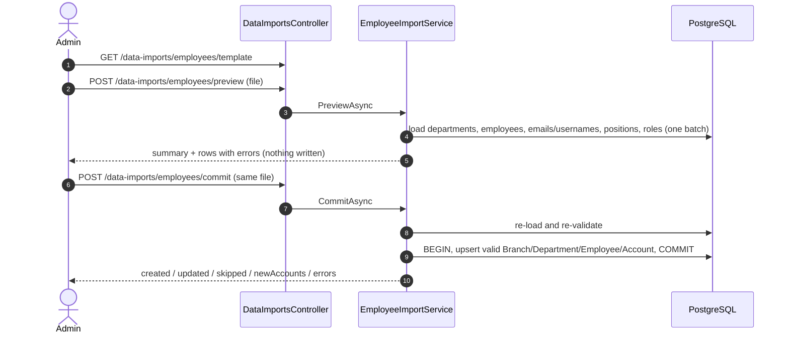

# Data Import API Contract

Admin-only, **stateless** employee/organization import from an Excel file exported by HRM (`02_Nhan_su_To_chuc.xlsx`):
`preview` validates the uploaded file without writing, `commit` takes the same file again, re-validates, commits valid rows and skips invalid rows.
Permission: `data_import:import` (ADMIN, SYSTEM_ADMIN = `All`). All responses use the `ApiResponse` envelope.

The reusable Excel part lives in `G54.BLL/Common/Import/**` (sheet reader, column/template declaration with alias and accent/note-insensitive header normalization, cell parsers, row error). A new import is a row class + a `TemplateBuilder` column declaration + a service that uses them; there is no engine, rule chain, registry or session store. The employee import is `G54.BLL/Services/EmployeeImportService.cs`.

## Endpoints

| Method | Path | Body | Success |
|---|---|---|---|
| `GET` | `/data-imports/employees/template` | none | 200, `.xlsx` file |
| `POST` | `/data-imports/employees/preview` | multipart `file` (.xlsx, magic-byte checked, ≤ `SystemParameters:ImportMaxFileMb`, ≤ `ImportMaxRows` data rows) | 200 |
| `POST` | `/data-imports/employees/commit` | multipart `file` (same file as preview) | 200, `Cache-Control: no-store` |

A file that is missing, empty, has a header row but no data rows, over the size/row limit, not a real `.xlsx` (400 `VALIDATION_ERROR`), or missing a required template column (400 `IMPORT_TEMPLATE_INVALID`) is rejected before any row is read. Nothing is stored between preview and commit; the preview of a file never writes.

## Shapes

```json
ImportPreviewDto {
  "fileName": "02_Nhan_su_To_chuc.xlsx",
  "summary": { "totalRows": 21, "valid": 17, "invalid": 4, "create": 17, "update": 0 },
  "rows": [ImportPreviewRowDto...]
}
ImportPreviewRowDto { "rowNumber": 19, "action": "INVALID", "data": { "Email*": "long.mt", ... }, "errors": [{ "column": "Email*", "code": "DATA_IMPORT_INVALID_VALUE", "message": "..." }] }
ImportCommitResultDto {
  "created": 17,
  "updated": 0,
  "skipped": 4,
  "newAccounts": [{ "employeeCode": "NV001", "username": "an.nv@bank.vn", "temporaryPassword": "..." }],
  "errors": [{ "rowNumber": 19, "errors": [{ "column": "Email*", "code": "DATA_IMPORT_INVALID_VALUE", "message": "..." }] }]
}
```

`action` is `CREATE` (new `Mã NV*`), `UPDATE` (existing `Mã NV*`) or `INVALID`. All rows are returned (≤ `ImportMaxRows`); paging/filtering is done by the client.

`newAccounts[].temporaryPassword` is returned **exactly once**, in the commit response, with `Cache-Control: no-store`.
It is never logged or stored; it is a cryptographically random plaintext hashed with `IPasswordEncoder`.

## Template: `02_Nhan_su_To_chuc.xlsx`

Single sheet, header row 1, data from row 2. Columns are matched by normalized header name (trim, strip trailing `*` and parenthetical notes, accent- and case-insensitive), so a reordered file still imports. Fully blank rows are skipped; unknown extra columns (such as `Ghi chú (demo)`) are ignored.

| Header | Required | Notes |
|---|---|---|
| `Mã chi nhánh*` | yes | upper-cased |
| `Tên chi nhánh*` | yes | |
| `Mã CN cha` | no | accepted for compatibility, ignored (a branch has no parent) |
| `Mã phòng ban*` | yes | upper-cased |
| `Tên phòng ban*` | yes | |
| `Đơn vị cha` | no | blank = the row's own branch |
| `Mã NV*` | yes | upper-cased |
| `Họ tên*` | yes | |
| `Email*` | yes | lower-cased; becomes the account username |
| `Vị trí*` | yes | dropdown: `TELLER, SALES_OFFICER, DEPT_MANAGER, BRANCH_MANAGER, QA, HR_OFFICER, SYS_ADMIN` |
| `Mã quản lý trực tiếp` | no | employee code of the direct manager |
| `Trạng thái*` | yes | dropdown: `ACTIVE, ON_LEAVE, PENDING_RESIGNATION, TERMINATED` |

There is no hire-date column. (`employee.hire_date` still exists, nullable, and is not written by the import.)

## Validation (preview and commit)

1. Every `*` column must have a value (`REQUIRED_FIELD`).
2. `Email*` must be a valid email address with a domain containing `.` (`DATA_IMPORT_INVALID_VALUE`), must not belong to a different existing employee/account in the database (`DATA_IMPORT_DUPLICATE`), and duplicate emails within the file keep the **first** occurrence while flagging subsequent rows (`DATA_IMPORT_DUPLICATE`).
3. `Vị trí*` and `Trạng thái*` must be one of the values above (`DATA_IMPORT_INVALID_VALUE`).
4. Duplicate `Mã NV*` in the file keeps the **first** occurrence and flags only subsequent occurrences (`DATA_IMPORT_DUPLICATE`, referencing the first row number). The first occurrence is the first row in file order, whether or not it is valid: if that row is invalid for another reason, it is skipped and the later rows stay flagged as duplicates, so no row with that code is written. Fix the first row (or remove it) and re-import. The same rule applies to duplicate emails.
5. `Mã quản lý trực tiếp`, when set, must not be the employee itself (`DATA_IMPORT_INVALID_VALUE`) and must exist in the database or on a **valid** row in the file (`DATA_IMPORT_REFERENCE_NOT_FOUND`). If a manager row is invalid, its subordinates cascade to invalid until stable.

Deliberately **not** validated: code shape, maximum lengths, manager cycles among valid rows, branch/department consistency across rows (the first valid row of a code wins).

## Commit (partial commit)

When `commit` re-validates the file:
- If **zero** rows are valid, nothing is written: 422 `DATA_IMPORT_HAS_ERRORS`.
- Otherwise, valid rows are committed in one transaction (`IUnitOfWork.ExecuteInTransactionAsync`) and invalid rows are skipped and returned in `skipped` + `errors`:

1. Upsert Branches (`Department.LevelType = Branch`, `Status = ACTIVE`), then Departments (parent = `Đơn vị cha`, default the branch).
2. Upsert Employees by `Mã NV*`; `ManagerId` is assigned in a second pass once every valid employee in the batch exists.
3. For an employee newly created by this commit: create an `Account` (`Username` = email, random temporary password) and a `UserRole` for the role `PositionMapping` maps the position to.
4. `Trạng thái* = TERMINATED` sets `Employee.Status = Terminated` **and** locks the account (BR-22), for new and updated employees (`ON_LEAVE` and `PENDING_RESIGNATION` keep the account unlocked).
5. An employee that exists in the database but is absent from the file is never touched (BR-52).

A concurrent unique-index collision rolls the whole transaction back and returns 409 `DATA_IMPORT_CONFLICT`.

`PositionMapping` (template position → `job_position.code` / role code): `TELLER` → `TELLER`/`EMPLOYEE` · `SALES_OFFICER` → `SALES`/`EMPLOYEE` · `DEPT_MANAGER` → `DEPT_MANAGER`/`DEPT_MANAGER` · `BRANCH_MANAGER` → `BRANCH_MANAGER`/`BRANCH_MANAGER` · `QA` → `QA`/`VERIFIER` · `HR_OFFICER` → `HR_OFFICER`/`HR_OFFICER` · `SYS_ADMIN` → `SYS_ADMIN`/`SYSTEM_ADMIN`.

## Error codes

`IMPORT_TEMPLATE_INVALID` (400), `REQUIRED_FIELD`, `DATA_IMPORT_INVALID_VALUE`, `DATA_IMPORT_DUPLICATE`, `DATA_IMPORT_REFERENCE_NOT_FOUND` (row errors in preview and commit), `DATA_IMPORT_HAS_ERRORS` (422 when zero valid rows), `DATA_IMPORT_CONFLICT` (409).

## Sample workbook (`02_Nhan_su_To_chuc.xlsx`)

Branch `HN01`; departments `PGD-HK`, `PGD-BD`, `BGD`, `KSNB`, `HCNS`; 21 data rows (17 valid, 4 invalid on rows 19, 20, 21, 22): row 19 (`NV007`) has invalid email `long.mt`, row 20 (`NV008`) has blank name/email and unknown position `CREDIT_OFFICER`, row 21 repeats row 9's `NV005` (row 9 stays valid), row 22 (`NV019`) has unknown manager `NV099`.

## Sequence



## Out of scope (follow-up)

- BR-22's "return in-progress work to the department pool" on `TERMINATED` (depends on the Work flow).
- The FE import screen.
