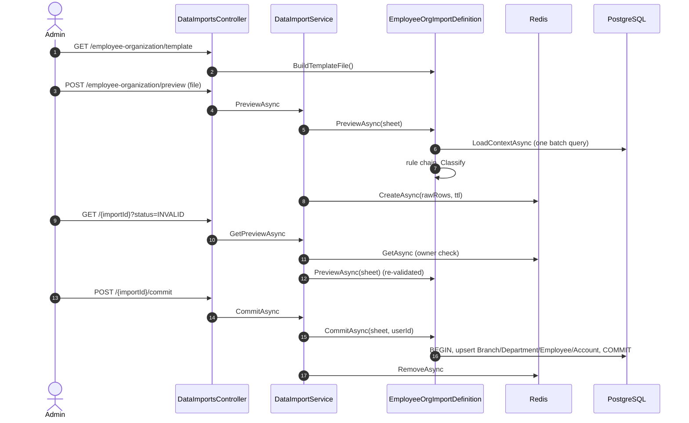

# Data Import API Contract

Admin-only, 2-step data import (upload → preview/validate → commit), built on a generic engine
(`G54.BLL/Common/Import/**`) so a new import type (Transaction, Service rating, ...) is one definition class
plus one DI line, not a new controller. The first definition is **Employee/Organization**
(`G54.BLL/Services/Import/EmployeeOrganization/**`), importing `02_Nhan_su_To_chuc.xlsx`.
Permission: `data_import:import` (ADMIN, SYSTEM_ADMIN = `All`). All responses use the `ApiResponse` envelope.

## Endpoints

| Method | Path | Body | Success |
|---|---|---|---|
| `GET` | `/data-imports/{type}/template` | none | 200, `.xlsx` file |
| `POST` | `/data-imports/{type}/preview` | multipart `file` (.xlsx, magic-byte checked, ≤ `SystemParameters:ImportMaxFileMb`, ≤ `ImportMaxRows` data rows) | 201 + `Location` |
| `GET` | `/data-imports/{importId}?page&pageSize&status=` (pageSize default 20, max 200) | none | 200 |
| `POST` | `/data-imports/{importId}/commit` | none | 200, `Cache-Control: no-store` |
| `DELETE` | `/data-imports/{importId}` | none | 204 |

`type` today is only `employee-organization`. An unknown `type` is 404 `DATA_IMPORT_TYPE_NOT_FOUND`. A file that
is missing, empty, over the size/row limit, not a real `.xlsx`, or missing a required template column is 400
(`VALIDATION_ERROR` or `IMPORT_TEMPLATE_INVALID`).

`status` on `GET /data-imports/{importId}` filters rows by action: `CREATE | UPDATE | UNCHANGED | INVALID`.

### Session (no import table)

The preview session lives in Redis (`IDistributedCache`, key `import:session:{importId}`, JSON
`{type, ownerUserId, fileName, headers, rows, createdAt}`), TTL `SystemParameters:ImportPreviewTtlMinutes`
(default 30 min). Only the owner may `GET`/`commit`/`cancel` a session — any other caller, including a valid
`importId` for someone else's session, gets 404 (no IDOR signal). Every `GET`/`commit` re-runs the full
validation pipeline against **current** DB state (TOCTOU-safe); the cache holds only the uploaded raw rows, so a
Redis restart or TTL expiry just means "re-upload", never a stale decision. Commit deletes the session.

## Shapes

```json
ImportPreviewDto {
  "importId": "guid", "type": "employee-organization", "fileName": "02_Nhan_su_To_chuc.xlsx",
  "expiresAt": "2026-11-02T13:00:00+00:00",
  "summary": { "totalRows": 22, "valid": 17, "invalid": 5, "create": 17, "update": 0, "unchanged": 0 },
  "relatedEntities": [{ "kind": "BRANCH", "code": "HN01", "name": "CN Hà Nội", "parentCode": null, "action": "CREATE" }],
  "rows": { "items": [ImportPreviewRowDto...], "totalCount": 22, "page": 1, "pageSize": 20 }
}
ImportPreviewRowDto { "rowNumber": 19, "action": "INVALID", "data": { "Email*": "long.mt", ... }, "errors": [{ "column": "Email*", "code": "DATA_IMPORT_INVALID_EMAIL", "message": "..." }] }
ImportCommitResultDto { "created": 17, "updated": 0, "unchanged": 0, "newAccounts": [{ "employeeCode": "NV001", "username": "an@bank.local", "temporaryPassword": "..." }] }
```

`relatedEntities` lists records implied by the rows (here: branches and departments, `kind` = `BRANCH` / `DEPARTMENT`),
each with `action` `CREATE` / `UPDATE` / `UNCHANGED`. Import types without such records return `[]`.

`newAccounts[].temporaryPassword` is returned **exactly once**, in the commit response, with
`Cache-Control: no-store`. It is never logged and never written to Redis or any table; encoding uses
`IPasswordEncoder` with a cryptographically random plaintext (`RandomNumberGenerator`).

## Template: `02_Nhan_su_To_chuc.xlsx` (Employee/Organization)

Single sheet, header row 1, data from row 2. Columns are matched by normalized header name (trim, strip
trailing `*`, case-insensitive) so a reordered file still imports; a missing required column is a file-level
400 `IMPORT_TEMPLATE_INVALID`.

| Header | Required | Notes |
|---|---|---|
| `Mã chi nhánh*` | yes | code, upper, `^[A-Za-z0-9][A-Za-z0-9_-]*$`, ≤ 50 |
| `Tên chi nhánh*` | yes | ≤ 200 |
| `Mã CN cha` | no | must be blank — a branch cannot have a parent |
| `Mã phòng ban*` | yes | same code shape |
| `Tên phòng ban*` | yes | ≤ 200 |
| `Đơn vị cha` | no | blank defaults to the row's own branch code; must resolve to a BRANCH |
| `Mã NV*` | yes | employee code |
| `Họ tên*` | yes | ≤ 200 |
| `Email*` | yes | lower-cased, simple email shape, ≤ 255 |
| `Vị trí*` | yes | dropdown: `TELLER, SALES_OFFICER, DEPT_MANAGER, BRANCH_MANAGER, QA, HR_OFFICER, SYS_ADMIN` |
| `Mã quản lý trực tiếp` | no | employee code of the direct manager |
| `Trạng thái*` | yes | dropdown: `ACTIVE, ON_LEAVE, PENDING_RESIGNATION, TERMINATED` |
| `Ngày vào làm*` | yes | `dd/MM/yyyy` or an Excel date cell; not in the future |
| any other column (e.g. `Ghi chú`) | no | ignored |

## Rules (Employee/Organization)

1. Every `*` column must have a value (`REQUIRED_FIELD`).
2. Codes normalize to UPPER and must match the shared code shape; email lower-cases; max lengths as above
   (`DATA_IMPORT_INVALID_CODE`, `DATA_IMPORT_INVALID_EMAIL`, `DATA_IMPORT_MAX_LENGTH_EXCEEDED`).
3. `Vị trí*` must be one of the 7 positions (`DATA_IMPORT_INVALID_POSITION`); `Trạng thái*` must be one of the 4
   template values above, so `INACTIVE` is rejected (`DATA_IMPORT_INVALID_STATUS`).
4. `Ngày vào làm*` must parse and not be in the future (`DATA_IMPORT_INVALID_DATE`).
5. A duplicate `Mã NV*` or `Email*` within the file flags **every** row in the duplicate group, not just the
   second occurrence (`DATA_IMPORT_DUPLICATE_CODE` / `DATA_IMPORT_DUPLICATE_EMAIL`).
6. An email already used by a different employee in the DB is rejected (`DATA_IMPORT_EMAIL_IN_USE`); an
   existing `Mã NV*` is classified `UPDATE` instead of erroring. The email is also rejected (same code) when it is
   already the username of another employee's account, because new accounts use the email as username.
7. `Mã quản lý trực tiếp` must resolve in the file or the DB (`DATA_IMPORT_MANAGER_NOT_FOUND`); an employee
   cannot manage itself (`DATA_IMPORT_MANAGER_SELF`); the manager graph built from file + DB must not cycle
   (`DATA_IMPORT_MANAGER_CYCLE`).
8. Rows sharing a branch/department code must agree on name and parent (`DATA_IMPORT_ORG_MISMATCH`); a branch
   code that already exists in the DB with a different level, or vice versa, is rejected
   (`DATA_IMPORT_ORG_LEVEL_MISMATCH`); a branch cannot have `Mã CN cha` (`DATA_IMPORT_BRANCH_HAS_PARENT`).
9. Upload limits: `.xlsx` extension + magic bytes (reuses the same signature check style as
   `EvidenceFileValidator`), ≤ `SystemParameters:ImportMaxFileMb`, ≤ `SystemParameters:ImportMaxRows` (default
   5000) data rows; fully blank rows are skipped. Total uncompressed size of the .xlsx zip must be ≤ 100 MB
   (zip-bomb guard, 400).
10. Classification: Employee → `CREATE` (new `Mã NV*`) / `UPDATE` (any tracked field differs) / `UNCHANGED`;
    any row with an error is `INVALID`, independent of classification.

### Commit (all-or-nothing, same pattern as `TARGET_IMPORT_INVALID`/R8)

If any row is still `INVALID` when `commit` re-validates against current DB state, the whole commit is
rejected with 422 `DATA_IMPORT_HAS_ERRORS` — nothing is written. Otherwise, inside one transaction
(`IUnitOfWork.ExecuteInTransactionAsync`):

1. Upsert Branches (`Department.LevelType = Branch`, `Status = ACTIVE`).
2. Upsert Departments (upsert, parent resolved from branches above or the DB, `Status = ACTIVE`).
3. Upsert Employees; `ManagerId` is assigned in a second pass once every employee in the batch has an `Id`.
4. For an employee newly created by this commit: create an `Account` (`Username` = email, a
   cryptographically random temporary password hashed by `IPasswordEncoder`) and a `UserRole` for the role
   `PositionMapping` maps the position to.
5. `Trạng thái* = TERMINATED` sets `Employee.Status = Terminated` **and** locks the account
   (`Account.IsLocked = true`) — BR-22. This applies to both newly created and updated employees.
6. An employee that exists in the DB but is absent from the file is **never** touched — not deleted, not
   changed (BR-52). Audit logging is automatic via the existing interceptor.

`PositionMapping` (template position → `job_position.code` / role code): `TELLER` → `TELLER`/`EMPLOYEE` ·
`SALES_OFFICER` → `SALES`/`EMPLOYEE` · `DEPT_MANAGER` → `DEPT_MANAGER`/`DEPT_MANAGER` · `BRANCH_MANAGER` →
`BRANCH_MANAGER`/`BRANCH_MANAGER` · `QA` → `QA`/`VERIFIER` · `HR_OFFICER` → `HR_OFFICER`/`HR_OFFICER` ·
`SYS_ADMIN` → `SYS_ADMIN`/`SYSTEM_ADMIN`.

## Error codes

`DATA_IMPORT_TYPE_NOT_FOUND`, `IMPORT_TEMPLATE_INVALID`, `DATA_IMPORT_HAS_ERRORS`, `DATA_IMPORT_INVALID_CODE`,
`DATA_IMPORT_INVALID_EMAIL`, `DATA_IMPORT_INVALID_POSITION`, `DATA_IMPORT_INVALID_STATUS`,
`DATA_IMPORT_INVALID_DATE`, `DATA_IMPORT_DUPLICATE_CODE`, `DATA_IMPORT_DUPLICATE_EMAIL`,
`DATA_IMPORT_EMAIL_IN_USE`, `DATA_IMPORT_MANAGER_NOT_FOUND`, `DATA_IMPORT_MANAGER_SELF`,
`DATA_IMPORT_MANAGER_CYCLE`, `DATA_IMPORT_BRANCH_HAS_PARENT`, `DATA_IMPORT_ORG_MISMATCH`,
`DATA_IMPORT_ORG_LEVEL_MISMATCH`, `DATA_IMPORT_MAX_LENGTH_EXCEEDED`.

## Sample workbook used in tests

Mirrors the template: branch `HN01` "CN Hà Nội"; departments `PGD-HK`, `PGD-BD`, `BGD`, `KSNB`, `HCNS` (parent
`HN01`); employees `NV001`..`NV020` (manager codes such as `NV010`/`NV011`/`NV020`; `NV020` is
`BRANCH_MANAGER` with no manager). Rows 19-22 are intentionally invalid (bad email, missing name/email +
invalid position/date, duplicate `Mã NV*`, unknown manager code) — **and row 9 is also invalid**, because
rule 5 flags every row in a duplicate group: row 21 repeats row 9's `NV005`, so both are `INVALID`. That makes
5 invalid rows in total (9, 19, 20, 21, 22), not 4.

## Sequence



## Out of scope (follow-up)

- BR-22's "return in-progress work to the department pool" on `TERMINATED` (depends on the Work flow).
- `MISSING_IN_FILE` / batch metadata the FE historically showed (BR-52; the ERD intentionally has no import
  table, so this is derived, not stored).
- The FE import screen.
- Exposing `employee.hire_date` on the Employee API (added by this feature's migration but not yet surfaced).
