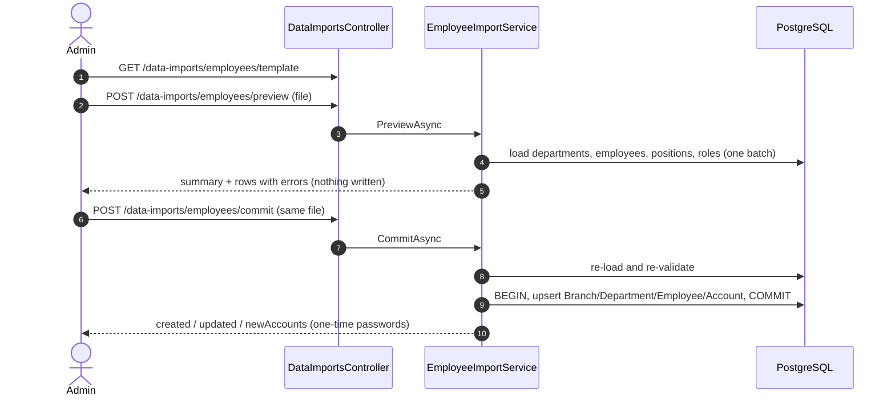

# Data Import API Contract

Admin-only, **stateless** employee/organization import from an Excel file exported by HRM (`02_Nhan_su_To_chuc.xlsx`):
`preview` validates the uploaded file without writing, `commit` takes the same file again, re-validates and writes.
Permission: `data_import:import` (ADMIN, SYSTEM_ADMIN = `All`). All responses use the `ApiResponse` envelope.

The reusable Excel part lives in `G54.BLL/Common/Import/**` (sheet reader, column/template declaration, cell
parsers, row error). A new import is a row class + a `TemplateBuilder` column declaration + a service that uses them;
there is no engine, rule chain, registry or session store. The employee import is `G54.BLL/Services/EmployeeImportService.cs`.

The file is trusted (generated by HRM), so validation is minimal: only what the write cannot do without.

## Endpoints

| Method | Path | Body | Success |
|---|---|---|---|
| `GET` | `/data-imports/employees/template` | none | 200, `.xlsx` file |
| `POST` | `/data-imports/employees/preview` | multipart `file` (.xlsx, magic-byte checked, ≤ `SystemParameters:ImportMaxFileMb`, ≤ `ImportMaxRows` data rows) | 200 |
| `POST` | `/data-imports/employees/commit` | multipart `file` (same file as preview) | 200, `Cache-Control: no-store` |

A file that is missing, empty, has a header row but no data rows, over the size/row limit, not a real `.xlsx` (400 `VALIDATION_ERROR`), or missing a
required template column (400 `IMPORT_TEMPLATE_INVALID`) is rejected before any row is read. Nothing is stored
between preview and commit; the preview of a file never writes.

## Shapes

```json
ImportPreviewDto {
  "fileName": "02_Nhan_su_To_chuc.xlsx",
  "summary": { "totalRows": 22, "valid": 17, "invalid": 5, "create": 17, "update": 0 },
  "rows": [ImportPreviewRowDto...]
}
ImportPreviewRowDto { "rowNumber": 19, "action": "INVALID", "data": { "Email*": "x@bank.local", ... }, "errors": [{ "column": "Trạng thái*", "code": "DATA_IMPORT_INVALID_VALUE", "message": "..." }] }
ImportCommitResultDto { "created": 17, "updated": 0, "newAccounts": [{ "employeeCode": "NV001", "username": "an@bank.local", "temporaryPassword": "..." }] }
```

`action` is `CREATE` (new `Mã NV*`), `UPDATE` (existing `Mã NV*`) or `INVALID`. All rows are returned (≤ `ImportMaxRows`);
paging/filtering is done by the client.

`newAccounts[].temporaryPassword` is returned **exactly once**, in the commit response, with `Cache-Control: no-store`.
It is never logged or stored; it is a cryptographically random plaintext hashed with `IPasswordEncoder`.

## Template: `02_Nhan_su_To_chuc.xlsx`

Single sheet, header row 1, data from row 2. Columns are matched by normalized header name (trim, strip trailing `*`,
case-insensitive), so a reordered file still imports. Fully blank rows are skipped; unknown extra columns are ignored.

| Header | Required | Notes |
|---|---|---|
| `Mã chi nhánh*` | yes | upper-cased |
| `Tên chi nhánh*` | yes | |
| `Mã CN cha` | no | accepted for compatibility, ignored (a branch has no parent) |
| `Mã phòng ban*` | yes | upper-cased |
| `Tên phòng ban*` | yes | |
| `Đơn vị cha` | no | blank = the row's own branch |
| `Mã NV*` | yes | upper-cased |
| `Họ tên*` | yes | |
| `Email*` | yes | lower-cased; becomes the account username |
| `Vị trí*` | yes | dropdown: `TELLER, SALES_OFFICER, DEPT_MANAGER, BRANCH_MANAGER, QA, HR_OFFICER, SYS_ADMIN` |
| `Mã quản lý trực tiếp` | no | employee code of the direct manager |
| `Trạng thái*` | yes | dropdown: `ACTIVE, ON_LEAVE, PENDING_RESIGNATION, TERMINATED` |

There is no hire-date column. (`employee.hire_date` still exists, nullable, and is not written by the import.)

## Validation (preview and commit)

1. Every `*` column must have a value (`REQUIRED_FIELD`).
2. `Vị trí*` and `Trạng thái*` must be one of the values above (`DATA_IMPORT_INVALID_VALUE`).
3. `Mã quản lý trực tiếp`, when set, must not be the employee itself (`DATA_IMPORT_INVALID_VALUE`) and must exist in
   the file or the database (`DATA_IMPORT_REFERENCE_NOT_FOUND`).
4. A duplicate `Mã NV*` in the file flags **every** row of the group (`DATA_IMPORT_DUPLICATE`).

Deliberately **not** validated: email format, code shape, maximum lengths, manager cycles, branch/department
consistency across rows (the first row of a code wins), email or username collisions with existing data.

## Commit

If any row is `INVALID` when `commit` re-validates, nothing is written: 422 `DATA_IMPORT_HAS_ERRORS`. Otherwise,
inside one transaction (`IUnitOfWork.ExecuteInTransactionAsync`):

1. Upsert Branches (`Department.LevelType = Branch`, `Status = ACTIVE`), then Departments (parent = `Đơn vị cha`, default the branch).
2. Upsert Employees by `Mã NV*`; `ManagerId` is assigned in a second pass once every employee in the batch exists.
3. For an employee newly created by this commit: create an `Account` (`Username` = email, random temporary password)
   and a `UserRole` for the role `PositionMapping` maps the position to.
4. `Trạng thái* = TERMINATED` sets `Employee.Status = Terminated` **and** locks the account (BR-22), for new and updated employees.
5. An employee that exists in the database but is absent from the file is never touched (BR-52).

A unique-index collision (employee code, email, or username already in use) rolls the whole transaction back and
returns 409 `DATA_IMPORT_CONFLICT`. The message is file-level: the database does not say which row collided.

`PositionMapping` (template position → `job_position.code` / role code): `TELLER` → `TELLER`/`EMPLOYEE` ·
`SALES_OFFICER` → `SALES`/`EMPLOYEE` · `DEPT_MANAGER` → `DEPT_MANAGER`/`DEPT_MANAGER` · `BRANCH_MANAGER` →
`BRANCH_MANAGER`/`BRANCH_MANAGER` · `QA` → `QA`/`VERIFIER` · `HR_OFFICER` → `HR_OFFICER`/`HR_OFFICER` ·
`SYS_ADMIN` → `SYS_ADMIN`/`SYSTEM_ADMIN`.

## Error codes

`IMPORT_TEMPLATE_INVALID` (400), `REQUIRED_FIELD`, `DATA_IMPORT_INVALID_VALUE`, `DATA_IMPORT_DUPLICATE`,
`DATA_IMPORT_REFERENCE_NOT_FOUND` (row errors in the preview), `DATA_IMPORT_HAS_ERRORS` (422),
`DATA_IMPORT_CONFLICT` (409).

## Sample workbook used in tests

Branch `HN01`; departments `PGD-HK`, `PGD-BD`, `BGD`, `KSNB`, `HCNS`; employees `NV001`..`NV020`. Invalid rows are
9, 19, 20, 21, 22: row 19 has status `INACTIVE`, row 20 has no name/email and an unknown position, row 21 repeats
row 9's `NV005` (so row 9 is flagged too), row 22 has an unknown manager.

## Sequence



## Out of scope (follow-up)

- BR-22's "return in-progress work to the department pool" on `TERMINATED` (depends on the Work flow).
- The FE import screen.
