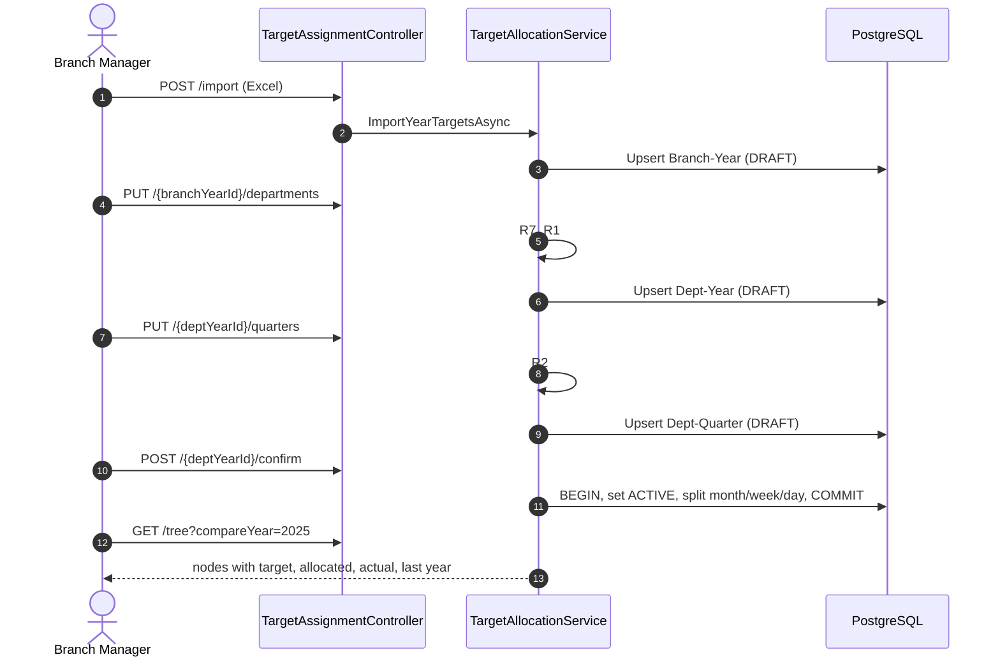

# Target Allocation API Contract

Branch Manager allocates yearly KPI targets: Branch-Year (Excel import) -> Department-Year -> Department-Quarter -> auto Month/Week/Day.
Permission: `target:manage` (ADMIN = All, MANAGER = Department). All responses use the `ApiResponse` envelope.

## Endpoints

| Method | Path | Body | Success |
|---|---|---|---|
| `POST` | `/target-assignments/import?branchId&year` | multipart `file` (.xlsx, max 5 MB; col A = KPI name, col B = year value, row 1 = header) | 201 |
| `PUT` | `/target-assignments/{branchYearId}/departments` | `{ "items": [{ "departmentId", "kpiDefinitionId", "targetValue" }], "changeReason" }` | 200 |
| `PUT` | `/target-assignments/{deptYearId}/quarters` | `{ "items": [{ "quarterPeriodId", "kpiDefinitionId", "targetValue" }], "changeReason" }` | 200 |
| `POST` | `/target-assignments/{deptYearId}/confirm` | none | 200 |
| `GET` | `/target-assignments/tree?branchId&year&compareYear` | none | 200 |

## Rules

- R1: department year targets add up to at least the branch year target (else 422 `TARGET_DEPARTMENT_SUM_BELOW`).
- R2: a department's quarters add up to at least its year target (else 422 `TARGET_QUARTER_SUM_BELOW`).
- R3: import and allocation create `DRAFT` rows; `confirm` sets them `ACTIVE` and creates month/week/day rows.
- R4: changing an `ACTIVE` row marks it `SUPERSEDED` and inserts `Version + 1` with `changeReason`.
- R5: the split is weighted by working days (Mon-Fri); the last part takes the rounding remainder. If no WEEK periods exist, days hang directly under the month.
- R6: the period must be `OPEN` (else 409 `TARGET_PERIOD_NOT_OPEN`).
- R7: each department must be a direct child of the branch (else 422 `TARGET_DEPARTMENT_NOT_IN_BRANCH`).
- R8: import is all-or-nothing; invalid rows return 400 `TARGET_IMPORT_INVALID` with one error line per row.

## Behaviour fixed by the database rules (found while testing against Postgres)

- `confirm` needs exact sums, not "at least": the DB trigger `validate_target_children_sum` requires ACTIVE children of an ACTIVE SUM-KPI parent to add up exactly. `PUT` still accepts a sum at or above the parent (R1/R2), but `confirm` returns 422 `TARGET_INVALID_STATE` unless the quarters equal the department year target (and, once every department is confirmed, the departments equal the branch year target).
- The branch-year row turns `ACTIVE` only after every department-year row under it is `ACTIVE`.
- `PUT .../departments` and `PUT .../quarters` replace the full set: the sum check uses only the items in the request, so send every department or quarter each time.
- Changing an `ACTIVE` row needs `changeReason`, otherwise 400.
- DAY periods sit directly under MONTH in the database, and ACTIVE children must sum to the parent, so only months and days are stored (daily rows hang off the month row). Week totals are derived from the day rows by date, and no WEEK target rows are written.
- Generated month and day rows take the next free version for their period (unique index on KPI, department, period, version), so a re-confirm produces version 2, 3 and so on.
- A quarter or year target that already exists for the same department and KPI outside this allocation (for example the seeded 2026-Q4 targets) returns 409 `TARGET_INVALID_STATE`.

## Error codes

`TARGET_DEPARTMENT_SUM_BELOW`, `TARGET_QUARTER_SUM_BELOW`, `TARGET_PERIOD_NOT_OPEN`, `TARGET_DEPARTMENT_NOT_IN_BRANCH`, `TARGET_IMPORT_INVALID`, `TARGET_INVALID_STATE`.

## Sequence

