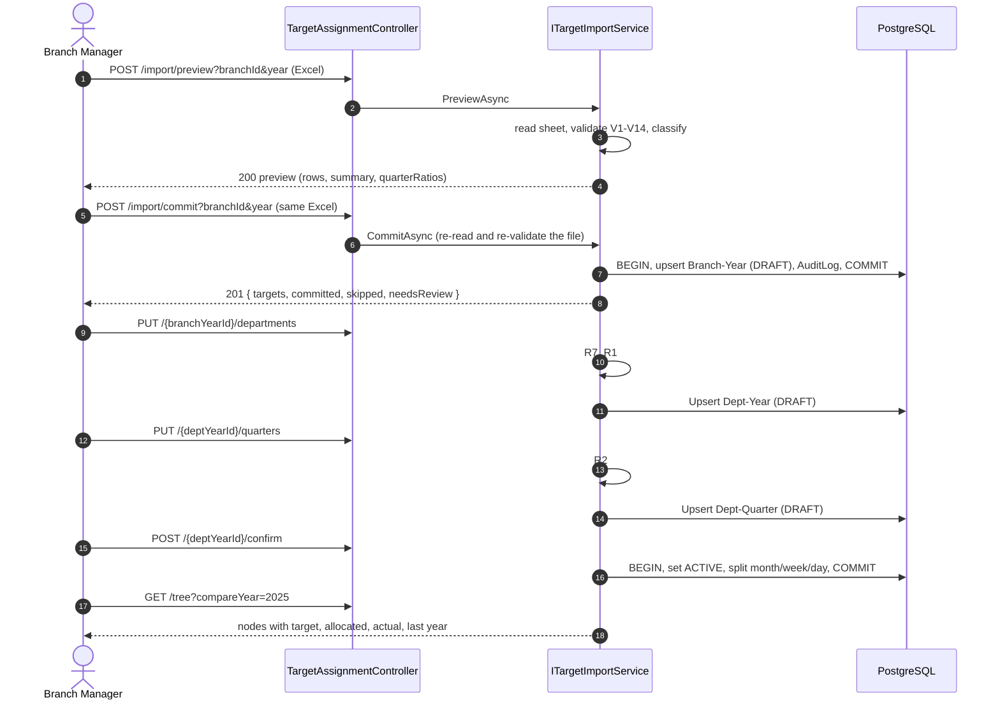

# Target Allocation API Contract

Branch Manager allocates yearly KPI targets: Branch-Year (Excel import) -> Department-Year -> Department-Quarter -> auto Month/Week/Day.
Permission: `target:manage` (SYSTEM_ADMIN = All, DEPT_MANAGER = Department). All responses use the `ApiResponse` envelope.

## Phase 1: year target import

`POST /target-assignments/import` (the old 2-column `col A = KPI name / col B = value` parser) is **replaced** by
the stateless preview/commit flow below (same shape as the Employee import, docs/api/DATA_IMPORT_CONTRACT.md:
nothing is stored between the two calls; commit re-uploads the file and re-validates it), which reads the real `KPI Năm-Quý` sheet (header on row 4, `Mã KPI`/`Năm {year}`
columns, Q1-Q4 ratios). See `docs/design/BRANCH_YEAR_KPI_IMPORT_DESIGN.md` for the full rule set (V1-V14).

| Method | Path | Body | Success |
|---|---|---|---|
| `GET` | `/target-assignments/import/template?year` | none | 200, `application/vnd.openxmlformats-officedocument.spreadsheetml.sheet` |
| `POST` | `/target-assignments/import/preview?branchId&year` | multipart `file` (.xlsx, max 10 MB, max 500 data rows) | 200 |
| `POST` | `/target-assignments/import/commit?branchId&year` | multipart `file` (the same file as the preview) | 201 |
| `GET` | `/target-assignments/setup?branchId&year` | none | 200 (phase 1 returns the step-1 state) |

### File layout (year = the query parameter)

Sheet named `KPI Năm-Quý *` (first sheet if none matches). Header row is found by scanning rows 1-10 for a cell
`Mã KPI`; columns are matched by header text, not fixed letters: `Mã KPI`, `Tên KPI`, `Đơn vị`, `Chiều`, `Trọng số`,
`Năm {year-1}`, `Năm {year}`, `Q1`..`Q4`, `Tổng hợp`. Row 2 holds quarter ratios above `Q1`..`Q4`. An optional
`Mã chi nhánh` cell (`G2`) is checked against `branchId` when present. A data row is one whose `Mã KPI` matches
`^KPI_[A-Z0-9_]+$`; group/total/note rows are skipped. Formula cells use the file's cached value only (never
recalculated); a needed cell with no cache is a row error (`TARGET_IMPORT_FORMULA_NOT_CALCULATED`).

### `POST /import/preview?branchId&year`

Request: multipart `file`. Response `data`:

```json
{
  "fileName": "KPI_Chi_nhanh_2026.xlsx",
  "branchId": "guid",
  "year": 2026,
  "summary": { "total": 28, "valid": 27, "invalid": 1, "create": 10, "update": 15, "unchanged": 2 },
  "quarterRatios": { "q1": 0.22, "q2": 0.24, "q3": 0.25, "q4": 0.29 },
  "kpisNotInFile": [ { "kpiCode": "KPI_X", "kpiName": "..." } ],
  "rows": [
    {
      "rowNumber": 6,
      "kpiCode": "KPI_NFI",
      "kpiName": "Thu nhập thuần từ dịch vụ (NFI)",
      "unit": "VND",
      "value": 6000000000,
      "previousYearValue": 6000000000,
      "delta": 0,
      "deltaPercent": 0,
      "action": "CREATE",
      "errors": [ { "column": "Năm 2026", "code": "TARGET_IMPORT_INVALID_VALUE", "message": "..." } ],
      "warnings": [ { "column": "Trọng số", "code": "TARGET_IMPORT_PREV_YEAR_MISMATCH", "message": "..." } ]
    }
  ]
}
```

`action` is one of `CREATE`, `UPDATE`, `UNCHANGED`, `INVALID`. A row with any entry in `errors` always has
`action = INVALID` and is excluded from commit (R8).

### `POST /import/commit?branchId&year`

Request: multipart `file`, the same workbook the preview used. It is read and validated again against the current
DB state, so commit writes exactly what it checked; the AuditLog entry and the Branch-Year rows are written in one
transaction. 0 valid rows -> 422 `TARGET_IMPORT_NO_VALID_ROWS`, nothing written. Response `data`: `TargetImportResultDto`
(`branchId`, `year`, `targets: TargetNodeDto[]`) plus `committed`, `skipped`, and `needsReview` (true when any
DRAFT child row was marked `NEEDS_REVIEW: re-imported`, G6). 201 on success.

### `GET /import/template?year`

Workbook with the same layout as the sample file: ratio row 2, header row 4 with columns `Mã KPI, Tên KPI, Đơn vị,
Chiều, Trọng số, Năm {year-1}, Năm {year}, Q1, Q2, Q3, Q4, Tổng hợp`, and a `Mã chi nhánh` cell.

### `GET /setup?branchId&year`

Phase 1 response: `{ "hasBranchYear": bool, "importedAt": "ISO or null", "rowCount": int, "step": "IMPORT" }`.
Phase 2 extends the same route with the wizard state and completion counts (G19), see below. Both phases are implemented
by `TargetSetupService`; `step` and the counts are always returned.

## Phase 2: Quarter split, department allocation and publish (SCR-STRAT-04, 04-D1)

All routes require permission `target:manage` and department scope check via `DepartmentAccessGuard`. All responses use the `ApiResponse` envelope.

| Method | Path | Body | Success |
|---|---|---|---|
| `GET` | `/target-assignments/{branchYearId}/quarter-split` | none | 200 |
| `PUT` | `/target-assignments/{branchYearId}/quarter-split` | `{ "rows": [{ "kpiId", "q1", "q2", "q3", "q4" }] }` | 200 |
| `GET` | `/target-assignments/{branchYearId}/kpis/{kpiId}/allocation` | none | 200 |
| `PUT` | `/target-assignments/{branchYearId}/kpis/{kpiId}/allocation` | `{ "departments": [{ "departmentId", "year", "q1", "q2", "q3", "q4" }] }` | 200 |
| `POST` | `/target-assignments/{branchYearId}/publish` | none | 200 |

### `GET /target-assignments/setup?branchId&year` (updated)

Phase 2 extends the response with wizard state and per-KPI status:

```json
{
  "branchYearId": "guid or null (anchor for the quarter-split / allocation / publish routes)",
  "hasBranchYear": true,
  "importedAt": "2026-11-03T08:30:12Z",
  "rowCount": 28,
  "step": "ALLOCATE",
  "status": "DRAFT",
  "quarters": {
    "done": 26,
    "total": 28
  },
  "allocation": {
    "done": 24,
    "total": 28
  },
  "canPublish": false,
  "blockers": [
    { "kpiId": "guid", "kpiCode": "KPI_X", "kpiName": "..." }
  ]
}
```

`step` is one of: `IMPORT` (no branch-year), `QUARTER` (branch-year exists, quarters incomplete), `ALLOCATE` (quarters done, allocation incomplete), `PUBLISH` (all ready), `PUBLISHED` (already published).

`quarters` counts every SUM and AVG KPI (AVG quarters equal the year value). `allocation` and `blockers` count SUM KPIs only: AVG, RATIO and NO_AGGREGATION KPIs keep one branch-wide value, are not allocated to departments (the per-KPI and bulk allocation endpoints exclude or reject them), and never block publishing.

### `GET /{branchYearId}/quarter-split`

Response `data`:

```json
{
  "branchYearId": "guid",
  "year": 2026,
  "status": "DRAFT",
  "importedAt": "2026-11-03T08:30:12Z",
  "fileRatios": { "q1": 0.22, "q2": 0.24, "q3": 0.25, "q4": 0.29 },
  "quarters": [
    { "periodId": "guid", "quarter": 1, "locked": false }
  ],
  "rows": [
    {
      "kpiId": "guid",
      "kpiCode": "KPI_NFI",
      "kpiName": "Thu nhập thuần từ dịch vụ (NFI)",
      "unit": "VND",
      "groupCode": "TAI_CHINH",
      "groupName": "Tài chính & thu nhập",
      "aggregationType": "SUM",
      "isRatio": false,
      "yearValue": 6000000000,
      "q1": 1320000000,
      "q2": 1440000000,
      "q3": 1500000000,
      "q4": null,
      "previousYearValue": 5400000000,
      "previousYear": { "q1": 1100000000, "q2": 1200000000, "q3": 1300000000, "q4": 1400000000 },
      "previousYearActual": { "q1": 1050000000, "q2": 1180000000, "q3": 1290000000, "q4": 1410000000 },
      "sum": 4260000000,
      "diff": 1740000000,
      "matched": false
    }
  ]
}
```

- Rows are ordered by `groupCode`, then `kpiCode`.
- `q1`..`q4` are `null` when that quarter has not been split yet (all four `null` = "chưa chia"); `sum` treats `null` as 0.
- `aggregationType` is the KPI's wire value (`SUM`, `AVG`, `RATIO`, `NO_AGGREGATION`).
- `isRatio: true` for every non-`SUM` KPI (`AVG`, `RATIO`, `NO_AGGREGATION`): the value applies to each quarter
  unchanged, so `q1`..`q4` = `yearValue`, `sum` = `yearValue`, `diff` = 0, `matched` = true, and the row is read-only.
- Non-`SUM` KPIs need no split: `GET /setup` counts their quarters as done, and quarter save, allocation save and
  publish create or reset their branch-quarter rows to the year value.
- `previousYearValue`: last year's branch-year target for this KPI (ACTIVE), or `null` when there is none.
- `previousYear`: last year's branch-quarter targets, or `null` when last year had no quarter split.
- `previousYearActual`: last year's branch ACTUAL results per quarter (sum of VALID `ActualProgress.value` for this
  branch's KPI, grouped by quarter), or `null` when the KPI is not `SUM`-aggregated (ratio/read-only rows never get
  a suggestion from actuals), there is no previous year, or all four quarters are 0/absent.

### `PUT /{branchYearId}/quarter-split`

Request body: `{ "rows": [{ "kpiId": "guid", "q1": 1500000, "q2": 1500000, "q3": 1500000, "q4": 1500000 }] }` (`SUM` KPIs; rows for other KPIs are ignored and their quarters are auto-filled with the year value).

Response: same as GET. Validation:
- Quarters already finished (EndDate < today) or LOCKED/CLOSED are read-only (409 `PERIOD_LOCKED`).
- Σ quarters must equal year exactly (422 `TARGET_QUARTER_SUM_MISMATCH`).
- Branch-year must be DRAFT (409 `TARGET_INVALID_STATE`).

### `GET /{branchYearId}/kpis/{kpiId}/allocation`

Response `data`:

```json
{
  "kpiId": "guid",
  "kpiName": "Tiền gửi - giới thiệu",
  "unit": "triệu VND",
  "workType": "TELLER",
  "branch": {
    "year": 1500000000,
    "q1": 330000000,
    "q2": 360000000,
    "q3": 375000000,
    "q4": 435000000
  },
  "departments": [
    {
      "departmentId": "guid",
      "departmentName": "Phòng Giao dịch",
      "headcount": 14,
      "year": 1200000000,
      "q1": 264000000,
      "q2": 288000000,
      "q3": 300000000,
      "q4": 348000000,
      "previousYear": 1100000000,
      "previousYearActual": 1050000000,
      "matched": true
    }
  ],
  "totals": {
    "year": 1480000000,
    "q1": 325600000,
    "q2": 355200000,
    "q3": 370000000,
    "q4": 429200000
  },
  "remaining": {
    "year": 20000000,
    "q1": 4400000,
    "q2": 4800000,
    "q3": 5000000,
    "q4": 5800000
  },
  "hiddenDepartments": [
    { "departmentId": "guid", "departmentName": "Phòng KHCN", "reason": "no_headcount" }
  ]
}
```

`hiddenDepartments` lists departments without eligible employees for this KPI's work type.

Department row fields:
- `previousYear`: the department's last year `ACTIVE` target for this KPI, or `null` when it had none.
- `previousYearActual`: the department's last year ACTUAL result for this KPI — sum of VALID `ActualProgress.value`
  over every descendant assignment (quarter/team/employee splits) under the department's previous-year row — so the
  frontend can suggest a split by last year's actual results instead of its target. `null` when the department had
  no previous-year row or no VALID actuals.
- `deptYearId`: the department-year row's own id, or `null` when this department has no dept-year row yet (tier 2
  not yet saved/published for it). This is the Phase 3 anchor for `GET/PUT .../employee-allocation` and
  `POST .../publish-employees` — the frontend reaches tier-3 data for a department/KPI from this row directly,
  without a second lookup (W2/W8).

### `GET /{branchYearId}/allocations`

Bulk per-KPI allocation grid for the matrix view: one call returns every allocatable KPI of the branch-year instead
of one `GET /{branchYearId}/kpis/{kpiId}/allocation` call per KPI.

Response `data`: a JSON array of the same per-KPI object documented above for `GET /{branchYearId}/kpis/{kpiId}/allocation`
(each entry is exactly the per-KPI `GET` response shape), ordered the same way as quarter-split rows (KPI group code,
then KPI code):

```json
[
  { "kpiId": "guid", "kpiName": "Tiền gửi - giới thiệu", "unit": "triệu VND", "workType": "TELLER", "branch": { ... }, "departments": [ ... ], "totals": { ... }, "remaining": { ... }, "hiddenDepartments": [ ... ] }
]
```

A KPI is included only when it is allocatable and its quarter split is ready:
- `RATIO` and `NO_AGGREGATION` KPIs are branch-wide and never appear (same rule as the per-KPI `PUT` rejection).
- A KPI whose branch quarters are not yet fully split, or do not sum/match the year value (same check as
  `TARGET_QUARTERS_NOT_READY` on the per-KPI `PUT`), is silently omitted from the array rather than erroring — it
  simply appears once its quarter split (`PUT /{branchYearId}/quarter-split`) is saved.

Errors: 404 `NOT_FOUND` for an unknown/invalid `branchYearId`; 403 `FORBIDDEN` when the caller lacks department
access — same as the per-KPI `GET`.

### `PUT /{branchYearId}/kpis/{kpiId}/allocation`

Request body: `{ "departments": [{ "departmentId": "guid", "year": 1200000, "q1": 264000, "q2": 288000, "q3": 300000, "q4": 348000 }] }`.

Response: same as GET. Validation:
- All non-ratio KPIs for this branch-year must have quarters matched (409 `TARGET_QUARTERS_NOT_READY`).
- Departments in the request must be eligible (headcount > 0 for this KPI, 422 `TARGET_DEPARTMENT_NOT_ELIGIBLE`).
- Year sums must equal branch year exactly (422 `TARGET_ALLOCATION_SUM_MISMATCH` with `details`).
- Each department's quarters must equal its year exactly (422 `TARGET_DEPT_QUARTER_SUM_MISMATCH` with `details`).
  For `AVG` KPIs each department quarter must equal the department year instead (same error code).
- `RATIO` and `NO_AGGREGATION` KPIs are one branch-wide value and cannot be allocated (400 `VALIDATION_ERROR`).
  `AVG` KPIs are allocated: department years add up to the branch year.
- Branch-year must be DRAFT (409 `TARGET_INVALID_STATE`).

The 422 responses use the `ApiResponse` envelope with one human-readable entry per mismatch in `errors` (for example
`"Quý 1: tổng các phòng = 200, chỉ tiêu chi nhánh = 250."`); the error code identifies the kind of mismatch.

### `POST /{branchYearId}/publish`

No body. Response `data`:

```json
{
  "publishedAt": "2026-11-03T12:30:00Z",
  "branchYearCount": 1,
  "quarterCount": 4,
  "departmentYearCount": 8,
  "departmentQuarterCount": 32
}
```

Validation:
- All non-ratio KPIs must have quarters matched and allocations matched (every department has a complete allocation,
  every department's quarters equal its year, and the department quarters add up to each branch quarter).
- 409 `TARGET_INVALID_STATE` if already published.
- 422 `TARGET_PUBLISH_BLOCKED` if any KPI is incomplete, with `details` listing the blockers.

Sets branch-year, branch-quarters, department-years and department-quarters to `ACTIVE`, `ApprovedAt = now`, in one transaction. Writes an AuditLog. **Does not generate month/day rows** (out of scope). Triggers `validate_target_children_sum` (DB trigger) on commit.

## Phase 3: Tier 3 employee allocation (department -> employee)

Target Allocation v3 (`docs/plans/TARGET_ALLOCATION_V3_DECISIONS.md`) adds a third tier: once a department's own
tier (tier 2, the Phase 2 allocation above) is **Published** (its department-year row is `ACTIVE`), the Branch
Manager / Department Manager splits that department's KPI target across its employees. Only employees holding a
responsible position for the KPI (an active evaluation profile item, falling back to the work-type link used for
department headcount) are editable; everyone else is locked with reason `not_responsible_position`.

Unlike the branch-year anchor (which covers several KPI rows for one branch+year), a department-year row
(`deptYearId`) already pins **department + KPI + year** — there is exactly one department-year row per KPI per
department — so these routes take no separate `kpiId` segment.

All routes require permission `target:manage` and department scope check via `DepartmentAccessGuard`. All responses
use the `ApiResponse` envelope.

| Method | Path | Body | Success |
|---|---|---|---|
| `GET` | `/target-assignments/{deptYearId}/employee-allocation` | none | 200 |
| `GET` | `/target-assignments/{deptYearId}/employee-allocations` | none | 200 |
| `PUT` | `/target-assignments/{deptYearId}/employee-allocation` | `{ "employees": [{ "employeeId", "year", "q1", "q2", "q3", "q4" }] }` | 200 |
| `POST` | `/target-assignments/{deptYearId}/publish-employees` | none | 200 |

### `GET /{deptYearId}/employee-allocation`

Response `data`:

```json
{
  "deptYearId": "guid",
  "kpiId": "guid",
  "kpiName": "Tiền gửi - giới thiệu",
  "unit": "triệu VND",
  "departmentId": "guid",
  "departmentName": "Phòng Giao dịch",
  "status": "ACTIVE",
  "department": { "year": 400000000, "q1": 100000000, "q2": 100000000, "q3": 100000000, "q4": 100000000, "previousYear": 360000000 },
  "employees": [
    {
      "employeeId": "guid",
      "employeeName": "Nguyễn Văn A",
      "jobPositionName": "Teller",
      "year": 100000000,
      "q1": 25000000,
      "q2": 25000000,
      "q3": 25000000,
      "q4": 25000000,
      "previousYear": 90000000,
      "previousYearActual": 92000000,
      "matched": true
    }
  ],
  "totals": { "year": 400000000, "q1": 100000000, "q2": 100000000, "q3": 100000000, "q4": 100000000 },
  "remaining": { "year": 0, "q1": 0, "q2": 0, "q3": 0, "q4": 0 },
  "lockedEmployees": [ { "employeeId": "guid", "employeeName": "Trần Thị B", "reason": "not_responsible_position" } ]
}
```

- `department`: the department's own target for this KPI (read-only ceiling for the grid; same shape as `branch` in
  the Phase 2 department-allocation response).
- `employees`: only employees eligible for this KPI (position-based); `previousYear`/`previousYearActual` mirror the
  Phase 2 department row fields one tier down (last year's `ACTIVE` employee-year row and the sum of its VALID
  descendant actuals).
- `lockedEmployees`: ineligible employees of the department, always `reason: "not_responsible_position"`.
- `status` is the department-year row's own status (`DRAFT` before tier 2 is published, `ACTIVE` after). Viewing is
  always allowed; only `PUT`/`publish-employees` require `ACTIVE` (409 `TARGET_TIER_NOT_PUBLISHED`).

### `GET /{deptYearId}/employee-allocations`

Bulk variant: every KPI's employee-allocation grid for the department that owns `deptYearId`, same per-KPI object as
above, ordered like quarter-split/department-allocation rows (KPI group code, then KPI code).

### `PUT /{deptYearId}/employee-allocation`

Request body: `{ "employees": [{ "employeeId": "guid", "year": 100000000, "q1": 25000000, "q2": 25000000, "q3": 25000000, "q4": 25000000 }] }`.
The request is the full set for this KPI: employees omitted that currently have a `DRAFT` row are removed.

Validation:
- Department tier (tier 2) must already be `ACTIVE` (409 `TARGET_TIER_NOT_PUBLISHED`).
- If any employee-year row for this KPI is already `ACTIVE` (tier 3 already published for it), the whole request is
  rejected (409 `TARGET_INVALID_STATE`) rather than edited in place — editing a published tier is only done through
  mid-term adjustment (D12/D13, deferred in this increment).
- Every employee in the request must be eligible (hold a responsible position for the KPI; 422
  `TARGET_EMPLOYEE_NOT_ELIGIBLE`).
- Employee years must sum to the department year exactly (422 `TARGET_EMPLOYEE_ALLOCATION_SUM_MISMATCH`).
- Each employee's quarters must equal their year exactly — sum for additive (CUMULATIVE/SUM) KPIs, each quarter
  equal to the year otherwise (422 `TARGET_EMPLOYEE_QUARTER_SUM_MISMATCH` with `details`).
- Locked/past quarters are read-only (409 `PERIOD_LOCKED`), same rule as Phase 2.

### `POST /{deptYearId}/publish-employees`

Publishes employee allocations for **every** KPI of the department that owns `deptYearId` at once (mirrors the
branch-wide Phase 2 `publish`), not just the one KPI the anchor row belongs to. No body. Response `data`:

```json
{ "publishedAt": "2026-11-18T12:00:00Z", "departmentId": "guid", "year": 2027, "employeeYearCount": 12, "employeeQuarterCount": 48 }
```

Validation:
- Department tier (tier 2) must already be `ACTIVE` (409 `TARGET_TIER_NOT_PUBLISHED`).
- For every KPI whose department-year row is `ACTIVE` and has at least one eligible employee: every eligible
  employee must have an employee-year row, their sum must equal the department year, and their quarters must match
  their year — otherwise 422 `TARGET_EMPLOYEE_PUBLISH_BLOCKED` with one human-readable entry per incomplete KPI in
  `errors`. A KPI with zero eligible employees in this department is skipped (nothing to publish, not a blocker).

Sets every covered employee-year and employee-quarter row to `ACTIVE`, `ApprovedAt = now`, in one transaction, and
writes an `AuditLog` entry (`EntityName = "EmployeeTargetPublish"`, `EntityId = "{departmentId}:{year}"`).

## Mid-term adjustment (Target Allocation v3, D12/D13)

Once a tier is published (`ACTIVE`), the **only** way to change its values is this flow — the regular
`PUT .../quarter-split`, `PUT .../kpis/{kpiId}/allocation` and `PUT .../employee-allocation` all reject an edit of
an already-`ACTIVE` row (409 `TARGET_INVALID_STATE`). Writes go through the existing versioning columns on
`target_assignment` (R4): the old row is marked `SUPERSEDED` (`EffectiveTo = today`) and a new `ACTIVE` row is
inserted at `Version + 1` with `PreviousVersionId` pointing at it and `ChangeReason` set from the request. Every
changed leaf value gets one `TargetChangeLog` entry (`action: ADJUST`). All routes require permission
`target:manage` and department scope via `DepartmentAccessGuard`.

| Method | Path | Body | Success |
|---|---|---|---|
| `PUT` | `/target-assignments/{branchYearId}/quarter-split/adjust` | `{ "rows": [{ "kpiId", "q1", "q2", "q3", "q4" }], "changeReason" }` | 200 |
| `PUT` | `/target-assignments/{branchYearId}/kpis/{kpiId}/allocation/adjust` | `{ "departments": [{ "departmentId", "year", "q1", "q2", "q3", "q4" }], "changeReason" }` | 200 |
| `PUT` | `/target-assignments/{deptYearId}/employee-allocation/adjust` | `{ "employees": [{ "employeeId", "year", "q1", "q2", "q3", "q4" }], "changeReason" }` | 200 |
| `POST` | `/target-assignments/{branchYearId}/departments/{departmentId}/remind` | none | 200 |

`changeReason` is required (400 `VALIDATION_ERROR` if blank) on all three `PUT .../adjust` routes.

### `PUT /{branchYearId}/quarter-split/adjust` (BM, tier 1)

BM redistributes the branch's quarters for one or more already-`ACTIVE` KPIs; the branch-year value itself is
fixed (not editable here). Same shape and validation as `PUT .../quarter-split` (Σquarters = year exactly, 422
`TARGET_QUARTER_SUM_MISMATCH`; locked/past quarters read-only, 409 `PERIOD_LOCKED`), but requires the branch-year
and the targeted KPI rows to already be `ACTIVE` (409 `TARGET_INVALID_STATE` otherwise — use the regular `PUT`
before publish). Only quarters whose value actually changes are versioned. Response: same shape as `GET
.../quarter-split`.

### `PUT /{branchYearId}/kpis/{kpiId}/allocation/adjust` (BM, tier 2)

BM redistributes one KPI's department allocation. The request is the **full** department set already allocated
for this KPI (same as `PUT .../allocation`; adding/removing a department is rejected, 400 `VALIDATION_ERROR`).
Same sum validation as `PUT .../allocation` (422 `TARGET_ALLOCATION_SUM_MISMATCH` / `TARGET_DEPT_QUARTER_SUM_MISMATCH`)
and locked-quarter rule (409 `PERIOD_LOCKED`); requires every targeted department-year row to already be `ACTIVE`
(409 `TARGET_INVALID_STATE` otherwise). **D13**: a department whose year or quarter values actually change gets its
dept-year row and all 4 quarter children re-versioned together (so the quarter children never point at a
superseded parent). That department's existing tier-3 (employee-year + employee-quarter) rows are re-parented onto
the new dept-year row and **demoted to `DRAFT`** — they keep their own values untouched, so `GET
.../employee-allocation` still shows them (now mismatched: `remaining != 0`, `matched: false` against the new
department year) instead of disappearing, but they cannot stay `ACTIVE` because the database's deferred
children-sum trigger (`trg_validate_target_children_sum`) requires every `ACTIVE` child of an `ACTIVE` `SUM`-KPI
parent to sum exactly to it, which no longer holds. `PUT .../employee-allocation/adjust` treats these `DRAFT` rows
the same as `ACTIVE` ones (both count as "already published" for that endpoint) and republishes them to `ACTIVE`
with the DM's new numbers — this is the "DM rebalances and republishes" step the decision describes; no separate
publish call is needed. The department's manager (resolved the same way as `DepartmentDetailDto.manager`) gets a
best-effort `TARGET_REVISED` notification; a resolution failure never blocks the adjustment. Response: same shape
as `GET .../kpis/{kpiId}/allocation`.

### `PUT /{deptYearId}/employee-allocation/adjust` (DM, tier 3)

DM redistributes one department-year KPI row's employee allocation. The request is the **full** employee set
already assigned this KPI (same all-or-nothing rule as tier 2's adjust). Same sum/eligibility validation as `PUT
.../employee-allocation` (422 `TARGET_EMPLOYEE_ALLOCATION_SUM_MISMATCH` / `TARGET_EMPLOYEE_QUARTER_SUM_MISMATCH` /
`TARGET_EMPLOYEE_NOT_ELIGIBLE`) and locked-quarter rule; requires tier 3 to already have been published at some
point for this KPI (409 `TARGET_INVALID_STATE` if no employee-year row exists at all yet, besides superseded
history — use the regular `PUT` first). A row left `DRAFT` by a tier-2 adjustment that reopened this department as
mismatched (see above) counts the same as `ACTIVE` here. **D12**: every
employee whose year or quarter values actually change has their `EmployeeTargetAck` flipped — `CONFIRMED` or
`PENDING` → `RECONFIRM`, `confirmedAt` cleared — and gets a best-effort `TARGET_REVISED` notification telling them
to reconfirm. Response: same shape as `GET .../employee-allocation`.

### `POST /{branchYearId}/departments/{departmentId}/remind` (BM, W8)

One-off reminder to the department's manager to rebalance and (re)publish tier 3; no body, no state change besides
the notification. `departmentId` must be a direct child department of `branchYearId`'s branch (422 `VALIDATION_ERROR`
otherwise, reusing `TARGET_DEPARTMENT_NOT_IN_BRANCH`'s rule). Response `data`:
`{ "sentAt": "...", "recipientEmployeeId": "guid or null", "sent": true|false }` — `sent: false` (no error) when the
department has no resolvable manager.

## Progress rollup (W1/W2/W8)

Read-only per-department x KPI overview: target vs. achieved (reconciled actuals only) and how far tier 3 has
gotten for each department. Reuses the branch-year anchor like quarter-split/allocation.

| Method | Path | Body | Success |
|---|---|---|---|
| `GET` | `/target-assignments/{branchYearId}/progress` | none | 200 |

Response `data`:

```json
{
  "branchYearId": "guid",
  "year": 2027,
  "kpis": [
    {
      "kpiId": "guid", "kpiCode": "KPI_NFI", "kpiName": "...", "unit": "VND",
      "departments": [
        {
          "departmentId": "guid", "departmentName": "Phòng Giao dịch", "deptYearId": "guid",
          "target": 1200000000, "achieved": 780000000, "achievedPercent": 65.0,
          "allocatedToEmployeesPercent": 100.0, "employeesTotal": 14, "employeesConfirmed": 9
        }
      ]
    }
  ]
}
```

- Only allocatable (`SUM`) KPIs appear, same rule as the Phase 2 allocation routes; a department with no dept-year
  row for that KPI is omitted from its `departments` array.
- `achieved`: sum of VALID (reconciled) `ActualProgress` over the department-year row's whole descendant tree
  (dept-quarter + employee-year + employee-quarter), dated within the year period — never counts a result still
  `IN_REVIEW`.
- `allocatedToEmployeesPercent`: Σ employee-year targets under this department/KPI ÷ the department year target
  x 100; `0` when tier 3 has not been allocated at all yet.
- `employeesConfirmed`: employees assigned this KPI in this department whose own `(employee, year)`
  `EmployeeTargetAck` is `CONFIRMED`. The ack is per employee-year (covers every KPI together), not per KPI, so
  this reflects each employee's overall-year confirmation, not a per-KPI one.

## Ceiling/floor warning (D9, SystemParameter)

The suggestion engine (`POST /target-suggestions/{year}`, below) now enforces D9: `targetSuggestionCeilingPercent`
(group `TARGET_ALLOCATION`, SCR-ADM-04, default `30`) is read live from `SystemParameterStore`. Any suggested,
non-locked, newly-filled cell that deviates from its own basis value (the previous-year target/actual weight used
to proportion it) by more than this percent gets a non-blocking entry in the KPI's `warnings` array; the suggested
value itself is never clamped. See "Open issues" below for what is still not covered.

## Deferred (not in this increment)

The following Target Allocation v3 decisions are **not yet implemented** and are tracked as follow-up work (see
`docs/BE_STATUS.md`): the `BALANCE` KPI aggregation type (D2/D3/D4 — quarter = end-of-quarter balance level, only
Q4 = year required, suggestion path from last year's quarter-end/year-end ratio — the `BALANCE` enum value exists
on `KpiAggregationType` but nothing yet treats it differently from `SUM`/`RATIO`/`AVG`/`NO_AGGREGATION` in
`TargetSetupService` or `TargetSuggestionService`), and jointly-optimized tier 2/3 quarter rounding (the "Open
issues" note below still applies — each unit's quarters are rounded independently, not as a matrix, so the
cross-unit quarter sum can still need a manual nudge after a suggestion).

## Phase 2.1+ (deprecated, unchanged): departments, quarters, confirm

These endpoints are **deprecated** but kept for backward compatibility. Use Phase 2 endpoints instead.

| Method | Path | Body | Success |
|---|---|---|---|
| `PUT` | `/target-assignments/{branchYearId}/departments` | `{ "items": [{ "departmentId", "kpiDefinitionId", "targetValue" }], "changeReason" }` | 200 |
| `PUT` | `/target-assignments/{deptYearId}/quarters` | `{ "items": [{ "quarterPeriodId", "kpiDefinitionId", "targetValue" }], "changeReason" }` | 200 |
| `POST` | `/target-assignments/{deptYearId}/confirm` | none | 200 |
| `GET` | `/target-assignments/tree?branchId&year&compareYear` | none | 200 |

## Rules

- R1: department year targets add up to at least the branch year target (else 422 `TARGET_DEPARTMENT_SUM_BELOW`).
- R2: a department's quarters add up to at least its year target (else 422 `TARGET_QUARTER_SUM_BELOW`).
- R3: allocation creates `DRAFT` rows; `confirm` sets them `ACTIVE` and creates month/week/day rows.
- R4: changing an `ACTIVE` row marks it `SUPERSEDED` and inserts `Version + 1` with `changeReason`.
- R5: the split is weighted by working days (Mon-Fri); the last part takes the rounding remainder. If no WEEK periods exist, days hang directly under the month. **Out of scope for the year-target import**; untouched by phase 1.
- R6: the period must be `OPEN` (else 409 `TARGET_PERIOD_NOT_OPEN`).
- R7: each department must be a direct child of the branch (else 422 `TARGET_DEPARTMENT_NOT_IN_BRANCH`).
- **R8 (revised, D9): the year-target import is partial, not all-or-nothing.** Preview classifies every row; commit
  writes only the rows without errors and reports `committed`/`skipped` counts (MSG32 "Đã nhập x/y dòng, z dòng lỗi").
  A file-level problem (wrong template, missing `Mã KPI`/`Năm {year}` header, wrong branch) still rejects the whole
  file before any row is read. Commit with zero valid rows returns 422 `TARGET_IMPORT_NO_VALID_ROWS`. The Employee/
  Organization import is unaffected and stays all-or-nothing.
- R9 (G6): importing over a branch-year target that is still `DRAFT` replaces it in place and marks any DRAFT
  quarter/department child `NEEDS_REVIEW: re-imported` (`needsReview: true` in the commit response, no migration in
  phase 1). Importing over an `ACTIVE` branch-year target is blocked: 409 `TARGET_INVALID_STATE` ("revise targets via
  allocation", D5).

## Behaviour fixed by the database rules (found while testing against Postgres)

- `confirm` needs exact sums, not "at least": the DB trigger `validate_target_children_sum` requires ACTIVE children of an ACTIVE SUM-KPI parent to add up exactly. `PUT` still accepts a sum at or above the parent (R1/R2), but `confirm` returns 422 `TARGET_INVALID_STATE` unless the quarters equal the department year target (and, once every department is confirmed, the departments equal the branch year target).
- The branch-year row turns `ACTIVE` only after every department-year row under it is `ACTIVE`.
- `PUT .../departments` and `PUT .../quarters` replace the full set: the sum check uses only the items in the request, so send every department or quarter each time.
- Changing an `ACTIVE` row needs `changeReason`, otherwise 400.
- DAY periods sit directly under MONTH in the database, and ACTIVE children must sum to the parent, so only months and days are stored (daily rows hang off the month row). Week totals are derived from the day rows by date, and no WEEK target rows are written.
- Generated month and day rows take the next free version for their period (unique index on KPI, department, period, version), so a re-confirm produces version 2, 3 and so on.
- A quarter or year target that already exists for the same department and KPI outside this allocation (for example the seeded 2026-Q4 targets) returns 409 `TARGET_INVALID_STATE`.

## Error codes

**Year target import (Phase 1)**: `TARGET_IMPORT_KPI_NOT_FOUND`, `TARGET_IMPORT_KPI_INACTIVE`, `TARGET_IMPORT_INVALID_VALUE`,
`TARGET_IMPORT_UNIT_MISMATCH`, `TARGET_IMPORT_YEAR_COLUMN_MISSING`, `TARGET_IMPORT_BRANCH_MISMATCH`,
`TARGET_IMPORT_FORMULA_NOT_CALCULATED`, `TARGET_IMPORT_PREV_YEAR_MISMATCH` (warning), `TARGET_IMPORT_NO_VALID_ROWS`,
plus the generic `DATA_IMPORT_DUPLICATE_CODE`, `DATA_IMPORT_REQUIRED`.

**Quarter split & allocation (Phase 2)**: `TARGET_QUARTER_SUM_MISMATCH`, `TARGET_ALLOCATION_SUM_MISMATCH` (MSG14),
`TARGET_DEPT_QUARTER_SUM_MISMATCH` (BR-24), `TARGET_QUARTERS_NOT_READY`, `TARGET_DEPARTMENT_NOT_ELIGIBLE`,
`TARGET_PUBLISH_BLOCKED`, plus reused `PERIOD_LOCKED`, `TARGET_INVALID_STATE`.

**Employee allocation (Phase 3)**: `TARGET_TIER_NOT_PUBLISHED`, `TARGET_EMPLOYEE_NOT_ELIGIBLE`,
`TARGET_EMPLOYEE_ALLOCATION_SUM_MISMATCH`, `TARGET_EMPLOYEE_QUARTER_SUM_MISMATCH`, `TARGET_EMPLOYEE_PUBLISH_BLOCKED`,
plus reused `PERIOD_LOCKED`.

**Mid-term adjustment**: reuses the Phase 2/3 sum/eligibility codes above (`TARGET_QUARTER_SUM_MISMATCH`,
`TARGET_ALLOCATION_SUM_MISMATCH`, `TARGET_DEPT_QUARTER_SUM_MISMATCH`, `TARGET_EMPLOYEE_ALLOCATION_SUM_MISMATCH`,
`TARGET_EMPLOYEE_QUARTER_SUM_MISMATCH`, `TARGET_EMPLOYEE_NOT_ELIGIBLE`) plus `TARGET_INVALID_STATE` (409, not yet
published / already superseded), `PERIOD_LOCKED`, generic `VALIDATION_ERROR` (missing `changeReason`, or a
department/employee added or removed from the full set), and `TARGET_DEPARTMENT_NOT_IN_BRANCH` (remind).

**Deprecated (Phase 2.1+)**: `TARGET_DEPARTMENT_SUM_BELOW`, `TARGET_QUARTER_SUM_BELOW`, `TARGET_PERIOD_NOT_OPEN`.
`TARGET_DEPARTMENT_NOT_IN_BRANCH` is reused by the `remind` endpoint above (no longer deprecated-only).

`PERIOD_LOCKED` (409, BR-29): read-only when the period has status `LOCKED`/`CLOSED` or `EndDate < today`. See `PERIOD_LOCK_CONTRACT.md`.

`TARGET_IMPORT_INVALID` (old 2-column parser's file-level error) is retired along with that parser.

## Sequence



## Suggestion engine (Target Allocation v3, docs/plans/TARGET_ALLOCATION_V3_DECISIONS.md D1/D4/D5/D6/D8/D9)

Read-only. `POST /target-suggestions/{year}` computes a suggested split for one tier of the workflow above from last
year's targets or actuals; it writes nothing. The caller (frontend) reviews the result and saves it through the
existing `PUT .../quarter-split`, `PUT .../kpis/{kpiId}/allocation`, or `PUT .../employee-allocation` endpoints on
`TargetAssignmentController` — this is a separate controller/route (`target-suggestions`, not `target-assignments`)
so the two features can be built independently; see "Open issues" below for the resulting D11 note.

| Method | Path | Body | Success |
|---|---|---|---|
| `POST` | `/target-suggestions/{year}` | see below | 200 |

### Request

```json
{
  "tier": 1,
  "basis": "TARGET_LAST_YEAR",
  "anchorId": "guid",
  "kpiIds": ["guid"],
  "departmentId": null,
  "employees": "ALL",
  "periods": "YEAR_PLUS_4Q",
  "overwrite": "EMPTY_ONLY",
  "currentValues": [ { "unitId": "guid", "year": null, "q1": null, "q2": null, "q3": null, "q4": null, "locked": false } ],
  "rounding": { "moneyStep": 10000000, "countStep": 1, "mode": "NEAREST" },
  "remainder": { "method": "LARGEST_REMAINDER", "bufferUnitId": null }
}
```

- `tier`: `1` (branch -> quarters), `2` (branch -> departments, one or more KPIs), `3` (department -> employees, one KPI).
- `anchorId`: the `branchYearId` (tier 1/2) or `deptYearId` (tier 3) — the same anchor the Phase 2/3 GET/PUT endpoints
  take; tier 3 is therefore always scoped to the one KPI that `deptYearId` pins.
- `basis`: `TARGET_LAST_YEAR` (last year's `ACTIVE` target rows) or `ACTUAL_LAST_YEAR` (sum of last year's `VALID`
  `ActualProgress` rows). `ACTUAL_LAST_YEAR` requires a rounding step > 0 (actuals rarely land on a round number);
  `rounding` omitted or a step of 0 with this basis is rejected (400 `VALIDATION_ERROR`).
- `kpiIds`: optional filter (tier 1/2); omit for every `SUM`-aggregation KPI of the branch-year. `RATIO`/`AVG`/
  `NO_AGGREGATION` KPIs have nothing to suggest (fixed/branch-wide) and are skipped.
- `employees`: tier 3 only. `ALL` (default) suggests every eligible employee; `NEW_ONLY` only fills employees with no
  previous-year employee-year row for this KPI (new hires) and keeps every other eligible employee's current value
  fixed (locked, reason `not_new`).
- `overwrite`: `EMPTY_ONLY` keeps any cell that already has a value (from `currentValues` or persisted draft) fixed
  and only fills empty cells; `UNLOCKED` recomputes every cell that isn't period-locked.
- `currentValues`: the grid's current (possibly unsaved) values, read from the frontend's draft instead of a second
  DB read; a unit omitted here is treated as empty. `locked: true` always keeps that cell fixed regardless of `overwrite`.
- `rounding.moneyStep`/`countStep`: default `10,000,000` / `1` (D8); which one applies is chosen from the KPI's unit
  (money-looking units — VND/đồng/triệu/tỷ — use `moneyStep`, everything else uses `countStep`).
- `remainder.method`: `LARGEST_REMAINDER` (default, D1) or `BUFFER` (`bufferUnitId` required — a quarter's period id
  for tier 1, a department id for tier 2, an employee id for tier 3).

### Response `data`

```json
{
  "tier": 1,
  "basis": "TARGET_LAST_YEAR",
  "overwrite": "EMPTY_ONLY",
  "kpis": [
    {
      "kpiId": "guid",
      "kpiCode": "KPI_NFI",
      "kpiName": "...",
      "unit": "VND",
      "aggregationType": "SUM",
      "cells": [
        { "unitId": "guid", "unitName": "KPI_NFI", "year": 6000000000, "q1": 1320000000, "q2": 1440000000, "q3": 1500000000, "q4": 1740000000,
          "usedFallbackAverage": false, "overwritten": true, "locked": false, "lockReason": null }
      ],
      "lockedUnits": [ { "unitId": "guid", "unitName": "...", "reason": "no_headcount" } ],
      "total": 6000000000,
      "sumMatches": true,
      "disabledReason": null,
      "warnings": []
    }
  ],
  "warnings": []
}
```

- One entry in `kpis` per KPI in scope: tier 1/2 may return several; tier 3 always returns exactly one (the KPI
  `deptYearId` pins).
- `cells`: tier 1 is one cell per KPI (the 4 quarters); tier 2 is one cell per eligible department; tier 3 is one cell
  per eligible employee. `unitId` is the KPI id (tier 1) or the department/employee id (tier 2/3) — the same id
  `currentValues[].unitId` and `remainder.bufferUnitId` use.
- `usedFallbackAverage`: true when the suggestion used the no-history fallback instead of last year's data (the name is
  historical). Fallbacks, applied only when the basis has no usable history:
  - Tier 1 (a KPI with no previous-year quarters): progressive Q1:Q2:Q3:Q4 = 1:2:3:4 (10/20/30/40%).
  - Tier 2 (no department has history for the KPI): the year is split by each department's number of employees eligible
    for the KPI; its quarters follow the branch's quarter shape, or 1:2:3:4 when the branch has none. When only some
    departments have history, the others get no suggestion and a warning names them (no peer-average fallback).
  - Tier 3 (no eligible employee has history): the year is split equally across eligible employees; quarters follow the
    department's quarter shape, or 1:2:3:4 when it has none. Employees without history while others have it still take
    the same-position average (D6).
  The ceiling/floor warning (D9) is skipped for fallback cells.
- `lockedUnits`: ineligible departments (`no_headcount`) or employees (`not_responsible_position`), same reasons as
  the Phase 2/3 `hiddenDepartments`/`lockedEmployees` fields, plus `not_new` (tier 3, `employees: "NEW_ONLY"`).
- `disabledReason: "no_history"` and empty `cells`/`lockedUnits` only when a tier 2/3 KPI has no eligible department or
  employee at all; a missing history never disables the suggestion (see the fallbacks above).
- `warnings`: non-blocking notes, e.g. a department/employee quarter breakdown that doesn't add back up to the
  branch/department quarter after independent rounding (see "Open issues" below), or every cell already fixed.

### Open issues (reported, not fixed by this increment)

- **D11 conflict**: the decisions doc says to extend `TargetAssignmentController`/`target-assignments`, but this
  engine ships as its own controller and `target-suggestions` route so it could be built in parallel with other
  Target Allocation v3 work without touching shared files. Folding it into `TargetAssignmentController` later is a
  pure move (no behavior change).
- **Tier 2/3 quarter shape isn't jointly optimized.** Each department's/employee's suggested quarters are derived by
  re-applying the parent's own quarter ratio to that unit's suggested year value (so each unit's own quarters always
  sum to its own year value exactly), but that is computed independently per unit — after rounding, the sum of the
  per-unit quarters for a given quarter is not guaranteed to equal the parent's quarter value. The response flags
  this with a `warnings` entry when it happens instead of silently absorbing it; the existing `PUT` allocation
  endpoints still re-validate exact sums at save time, so nothing incorrect can be persisted.
- **Ceiling/floor ±X% warning (D9) is implemented** (see "Ceiling/floor warning" above): `targetSuggestionCeilingPercent`
  (default 30) flags a deviating cell with a warning; it is a warning only, never a clamp or a block.
- **BALANCE KPI aggregation (D2/D3/D4) is still not implemented.** `KpiAggregationType.Balance` exists as an enum
  value, but every KPI with it is still read by `TargetSetupService`/`TargetSuggestionService` as if it needed
  `IsPeriodAdditive` (Σquarters = year); nothing computes "only Q4 = year" or the quarter-end-ratio suggestion
  path yet. Tracked as follow-up.
- **Not batch-optimized.** Eligibility (tier 2 department headcount, tier 3 employee position) and previous-year
  actual roll-ups run one query set per department/employee rather than the batched queries `TargetSetupService`
  uses for the same checks; fine for a single suggestion call, worth revisiting if it is called in a tight loop.

## Employee side: "my-targets" (Target Allocation v3, BR-36)

Once tier 3 (employee allocation) is published, the employee sees their own targets, confirms them, leaves
feedback with an optional proposed value, and tracks quarter progress. Permission: `[Authorize]` only — the
caller's employeeId is always derived server-side from the authenticated account (same pattern as
`target-assignments/mine`), so no `target:manage` permission is needed to see or confirm one's own data. The DM
reply action is the one exception: it requires `target:manage` at `Department` scope (reuses the Phase 2/3
department-access rule), scoped to the replying DM's own department.

| Method | Path | Body | Success |
|---|---|---|---|
| `GET` | `/my-targets/{year}` | none | 200 |
| `POST` | `/my-targets/{year}/confirm` | none | 200 |
| `POST` | `/my-targets/{year}/feedback` | `{ "kpiId", "reason", "proposedYear"?, "proposedQ1".."proposedQ4"? }` | 201 |
| `POST` | `/my-targets/feedback/{feedbackId}/reply` | `{ "reply" }` | 200 |
| `GET` | `/my-targets/{year}/progress?period=` | none | 200 |
| `GET` | `/my-targets/{year}/feedback?departmentId=&employeeId=` | none | 200 |
| `GET` | `/my-targets/{year}/change-log?employeeId=&kpiId=` | none | 200 |
| `GET` | `/my-targets/{year}/my-feedback?kpiId=` | none | 200 |
| `GET` | `/my-targets/{year}/kpis/{kpiId}/contributions` | none | 200 |

### `GET /my-targets/{year}`

Response `data`:

```json
{
  "year": 2027,
  "employeeId": "guid",
  "employeeName": "Hoàng Thu Hà",
  "departmentId": "guid",
  "departmentName": "Phòng Giao dịch",
  "ackStatus": "PENDING",
  "confirmedAt": null,
  "kpis": [
    {
      "kpiId": "guid",
      "kpiCode": "KPI_ACC_OPEN",
      "kpiName": "Số tài khoản mở mới",
      "unit": "TK",
      "aggregationType": "SUM",
      "year": 120,
      "q1": 25, "q2": 25, "q3": 25, "q4": 45,
      "previousYearTarget": 100,
      "previousYearActual": 95,
      "changed": true,
      "changedOldValue": 100,
      "changedNewValue": 120,
      "hasFeedback": false
    }
  ]
}
```

- `ackStatus` is one of `PENDING` (tier-3 just published, not yet confirmed), `CONFIRMED`, `RECONFIRM` (a
  mid-term adjustment changed a KPI after the employee had confirmed, D12/D13). No `EmployeeTargetAck` row yet
  reads as `PENDING` with `confirmedAt: null`.
- `changed`/`changedOldValue`/`changedNewValue` come from the structured `TargetChangeLog` (D10): the latest
  non-`PUBLISH` (`ADJUST`/`MANUAL`) entry for that employee + year + KPI's `YEAR` period, if any.
- `previousYearTarget`/`previousYearActual` mirror the Phase 2/3 fields one tier down: last year's `ACTIVE`
  employee-year row and the sum of the employee's VALID `ActualProgress` for that KPI over last year's dates.
- `hasFeedback` is true when the employee has an open proposal (`proposedYear`/`proposedQ1..4` not null) on this
  KPI, regardless of whether the DM has replied yet.

### `POST /my-targets/{year}/confirm`

No body. Creates the `EmployeeTargetAck` row (status `CONFIRMED`) if none exists yet, or flips `PENDING`/
`RECONFIRM` to `CONFIRMED`. 409 `TARGET_ACK_INVALID_STATE` if already `CONFIRMED`. Response `data`:
`{ "year": 2027, "ackStatus": "CONFIRMED", "confirmedAt": "2027-01-10T09:00:00Z" }`.

### `POST /my-targets/{year}/feedback`

Request: `kpiId` must be one of the caller's own year-target KPIs for that year (404 `NOT_FOUND` otherwise).
`reason` is required, ≤ 500 characters (400 `MAX_LENGTH_EXCEEDED`, MSG08-style). `proposedYear`/`proposedQ1..4`
are optional; when the KPI is `SUM`-aggregated and a proposed year is given, Σ proposed quarters must equal it
exactly (422 `TARGET_FEEDBACK_PROPOSED_SUM_MISMATCH`). Writes one `TargetAssignmentFeedback` row (reusing the
existing `COMMENT` type, extended with the `proposed*` columns) and one `TargetChangeLog` entry
(`action: FEEDBACK`). 201 on success with the created `TargetFeedbackDto`.

### `POST /my-targets/feedback/{feedbackId}/reply`

DM-only (`target:manage` at `Department` scope, checked against the feedback owner's department). `reply` is
required, ≤ 500 characters. Sets `reply`, `repliedBy`, `repliedAt` on the feedback row and writes a
`TargetChangeLog` entry (`action: REPLY`). 404 `NOT_FOUND` for an unknown feedback id; 403 `FORBIDDEN` when the
DM is out of department scope.

### `GET /my-targets/{year}/progress?period=`

`period` is `YEAR` (default), `Q1`, `Q2`, `Q3` or `Q4`. For each of the caller's KPIs: `achieved` sums only VALID
`ActualProgress` (the auto-reconciled pipeline) over the period's dates — it never counts a `WorkTransaction`
still `IN_REVIEW`. `inReviewCount` is that still-pending count, reported separately so the UI can show it without
inflating the achieved bar. `expectedPacePercent`/`paceStatus` follow D16: `ACHIEVED` ≥ 100%; `ON_PACE` when
`achievedPercent - expectedPacePercent >= 0`; `SLOW` when the gap is in `[-10, 0)`; `AT_RISK` when the gap `< -10`.
Response `data`:

```json
{
  "year": 2027,
  "period": "2027-Q1",
  "kpis": [
    {
      "kpiId": "guid", "kpiCode": "KPI_ACC_OPEN", "kpiName": "Số tài khoản mở mới", "unit": "TK",
      "progress": {
        "target": 25, "achieved": 18, "inReviewCount": 3,
        "achievedPercent": 72, "expectedPacePercent": 65, "paceStatus": "ON_PACE"
      }
    }
  ]
}
```

### `GET /{year}/feedback?departmentId=&employeeId=` (DM, W9/W11)

DM-only (`target:manage` at `Department` scope, checked against `departmentId`). Lists every feedback row for
employees in that department for `year`, newest first; `employeeId` narrows it to one employee (W11 drawer). Same
`TargetFeedbackDto` shape as `POST .../feedback`/`.../reply`.

### `GET /{year}/change-log?employeeId=&kpiId=` (W11 drawer)

Allowed for the employee themselves, or their DM (`target:manage` at `Department` scope against the employee's
department; 403 `FORBIDDEN` otherwise). Returns the employee's `TargetChangeLog` rows for `year`, newest first;
`kpiId` narrows it to one KPI. Response `data`: array of
`{ "id", "occurredAt", "action", "tier", "kpiId", "kpiName", "unit", "period", "oldValue", "newValue", "basis" }`
(`action` is one of `SUGGEST`/`MANUAL`/`PUBLISH`/`ADJUST`/`FEEDBACK`/`REPLY`).

### `GET /{year}/my-feedback?kpiId=` (employee, E5)

The caller's own feedback history (with any DM reply), newest first; `kpiId` narrows it to one KPI. Same shape as
`GET .../feedback` above, scoped to the caller instead of a department (no `target:manage` needed, same as the
other `my-targets` routes).

### `GET /{year}/kpis/{kpiId}/contributions` (employee, E5)

The reconciled (or still-pending) transactions behind the caller's own result for one KPI/year. 404 `NOT_FOUND`
if the caller has no target for that KPI/year. Response `data`: array of
`{ "id", "transactionDate", "transactionCode", "cifCode", "referEmployeeCode", "amount", "status" }`. `status` is
`AUTO_RECONCILED` (matched to an imported transaction), `NOT_MATCHED`, or `IN_REVIEW` (still pending); `amount` is
the KPI-contribution value (`WorkResultItem.Value`), not necessarily the raw transaction amount.
`transactionCode`/`cifCode`/`referEmployeeCode` are `null` for a manually-entered actual with no transaction link.

### `MyTargetKpiRowDto` addition

`GET /{year}` rows now also carry `ceilingWarningPercent` (decimal, default informational only): the D9
`targetSuggestionCeilingPercent` SystemParameter value, read live — the same ceiling band the suggestion engine
warns against. `aggregationType` (SUM/RATIO/AVG/NO_AGGREGATION/BALANCE) was already present on this row.

### Deferred (not in this increment)

Employee-level Excel import for tier 3 (bulk-editing the employee-allocation grid from a spreadsheet, mirroring
the Phase 1 branch-year import) is not implemented; employee allocation is entered through the grid (`PUT
.../employee-allocation` / `.../adjust`) only. Tracked as follow-up if the BM/DM screens need it.

### Error codes (Employee side)

`TARGET_FEEDBACK_PROPOSED_SUM_MISMATCH`, `TARGET_ACK_INVALID_STATE`, plus reused `NOT_FOUND`, `FORBIDDEN`,
`MAX_LENGTH_EXCEEDED` (MSG08).
