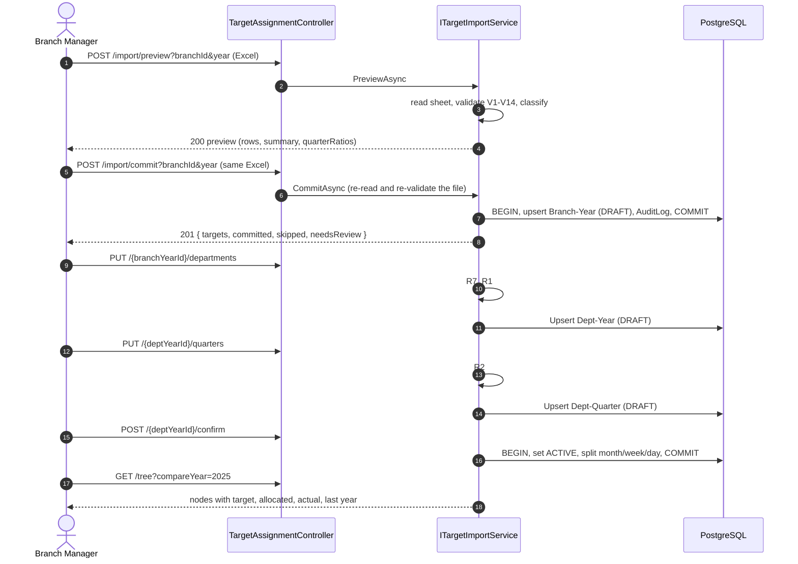

# Target Allocation API Contract

Branch Manager allocates yearly KPI targets: Branch-Year (Excel import) -> Department-Year -> Department-Quarter -> auto Month/Week/Day.
Permission: `target:manage` (ADMIN = All, MANAGER = Department). All responses use the `ApiResponse` envelope.

## Phase 1: year target import

`POST /target-assignments/import` (the old 2-column `col A = KPI name / col B = value` parser) is **replaced** by
the stateless preview/commit flow below (same shape as the Employee import, docs/api/DATA_IMPORT_CONTRACT.md:
nothing is stored between the two calls; commit re-uploads the file and re-validates it), which reads the real `KPI Năm-Quý` sheet (header on row 4, `Mã KPI`/`Năm {year}`
columns, Q1-Q4 ratios). See `docs/design/BRANCH_YEAR_KPI_IMPORT_DESIGN.md` for the full rule set (V1-V14).

| Method | Path | Body | Success |
|---|---|---|---|
| `GET` | `/target-assignments/import/template?year` | none | 200, `application/vnd.openxmlformats-officedocument.spreadsheetml.sheet` |
| `POST` | `/target-assignments/import/preview?branchId&year` | multipart `file` (.xlsx, max 10 MB, max 500 data rows) | 200 |
| `POST` | `/target-assignments/import/commit?branchId&year` | multipart `file` (the same file as the preview) | 201 |
| `GET` | `/target-assignments/setup?branchId&year` | none | 200 (phase 1 returns the step-1 state) |

### File layout (year = the query parameter)

Sheet named `KPI Năm-Quý *` (first sheet if none matches). Header row is found by scanning rows 1-10 for a cell
`Mã KPI`; columns are matched by header text, not fixed letters: `Mã KPI`, `Tên KPI`, `Đơn vị`, `Chiều`, `Trọng số`,
`Năm {year-1}`, `Năm {year}`, `Q1`..`Q4`, `Tổng hợp`. Row 2 holds quarter ratios above `Q1`..`Q4`. An optional
`Mã chi nhánh` cell (`G2`) is checked against `branchId` when present. A data row is one whose `Mã KPI` matches
`^KPI_[A-Z0-9_]+$`; group/total/note rows are skipped. Formula cells use the file's cached value only (never
recalculated); a needed cell with no cache is a row error (`TARGET_IMPORT_FORMULA_NOT_CALCULATED`).

### `POST /import/preview?branchId&year`

Request: multipart `file`. Response `data`:

```json
{
  "fileName": "KPI_Chi_nhanh_2026.xlsx",
  "branchId": "guid",
  "year": 2026,
  "summary": { "total": 28, "valid": 27, "invalid": 1, "create": 10, "update": 15, "unchanged": 2 },
  "quarterRatios": { "q1": 0.22, "q2": 0.24, "q3": 0.25, "q4": 0.29 },
  "kpisNotInFile": [ { "kpiCode": "KPI_X", "kpiName": "..." } ],
  "rows": [
    {
      "rowNumber": 6,
      "kpiCode": "KPI_NFI",
      "kpiName": "Thu nhập thuần từ dịch vụ (NFI)",
      "unit": "VND",
      "value": 6000000000,
      "previousYearValue": 6000000000,
      "delta": 0,
      "deltaPercent": 0,
      "action": "CREATE",
      "errors": [ { "column": "Năm 2026", "code": "TARGET_IMPORT_INVALID_VALUE", "message": "..." } ],
      "warnings": [ { "column": "Trọng số", "code": "TARGET_IMPORT_PREV_YEAR_MISMATCH", "message": "..." } ]
    }
  ]
}
```

`action` is one of `CREATE`, `UPDATE`, `UNCHANGED`, `INVALID`. A row with any entry in `errors` always has
`action = INVALID` and is excluded from commit (R8).

### `POST /import/commit?branchId&year`

Request: multipart `file`, the same workbook the preview used. It is read and validated again against the current
DB state, so commit writes exactly what it checked; the AuditLog entry and the Branch-Year rows are written in one
transaction. 0 valid rows -> 422 `TARGET_IMPORT_NO_VALID_ROWS`, nothing written. Response `data`: `TargetImportResultDto`
(`branchId`, `year`, `targets: TargetNodeDto[]`) plus `committed`, `skipped`, and `needsReview` (true when any
DRAFT child row was marked `NEEDS_REVIEW: re-imported`, G6). 201 on success.

### `GET /import/template?year`

Workbook with the same layout as the sample file: ratio row 2, header row 4 with columns `Mã KPI, Tên KPI, Đơn vị,
Chiều, Trọng số, Năm {year-1}, Năm {year}, Q1, Q2, Q3, Q4, Tổng hợp`, and a `Mã chi nhánh` cell.

### `GET /setup?branchId&year`

Phase 1 response: `{ "hasBranchYear": bool, "importedAt": "ISO or null", "rowCount": int, "step": "IMPORT" }`.
Phase 2 extends the same route with the wizard state and completion counts (G19), see below. Both phases are implemented
by `TargetSetupService`; `step` and the counts are always returned.

## Phase 2: Quarter split, department allocation and publish (SCR-STRAT-04, 04-D1)

All routes require permission `target:manage` and department scope check via `DepartmentAccessGuard`. All responses use the `ApiResponse` envelope.

| Method | Path | Body | Success |
|---|---|---|---|
| `GET` | `/target-assignments/{branchYearId}/quarter-split` | none | 200 |
| `PUT` | `/target-assignments/{branchYearId}/quarter-split` | `{ "rows": [{ "kpiId", "q1", "q2", "q3", "q4" }] }` | 200 |
| `GET` | `/target-assignments/{branchYearId}/kpis/{kpiId}/allocation` | none | 200 |
| `PUT` | `/target-assignments/{branchYearId}/kpis/{kpiId}/allocation` | `{ "departments": [{ "departmentId", "year", "q1", "q2", "q3", "q4" }] }` | 200 |
| `POST` | `/target-assignments/{branchYearId}/publish` | none | 200 |

### `GET /target-assignments/setup?branchId&year` (updated)

Phase 2 extends the response with wizard state and per-KPI status:

```json
{
  "branchYearId": "guid or null (anchor for the quarter-split / allocation / publish routes)",
  "hasBranchYear": true,
  "importedAt": "2026-11-03T08:30:12Z",
  "rowCount": 28,
  "step": "ALLOCATE",
  "status": "DRAFT",
  "quarters": {
    "done": 26,
    "total": 28
  },
  "allocation": {
    "done": 24,
    "total": 28
  },
  "canPublish": false,
  "blockers": [
    { "kpiId": "guid", "kpiCode": "KPI_X", "kpiName": "..." }
  ]
}
```

`step` is one of: `IMPORT` (no branch-year), `QUARTER` (branch-year exists, quarters incomplete), `ALLOCATE` (quarters done, allocation incomplete), `PUBLISH` (all ready), `PUBLISHED` (already published).

### `GET /{branchYearId}/quarter-split`

Response `data`:

```json
{
  "branchYearId": "guid",
  "year": 2026,
  "status": "DRAFT",
  "importedAt": "2026-11-03T08:30:12Z",
  "fileRatios": { "q1": 0.22, "q2": 0.24, "q3": 0.25, "q4": 0.29 },
  "quarters": [
    { "periodId": "guid", "quarter": 1, "locked": false }
  ],
  "rows": [
    {
      "kpiId": "guid",
      "kpiCode": "KPI_NFI",
      "kpiName": "Thu nhập thuần từ dịch vụ (NFI)",
      "unit": "VND",
      "isRatio": false,
      "yearValue": 6000000000,
      "q1": 1320000000,
      "q2": 1440000000,
      "q3": 1500000000,
      "q4": 1740000000,
      "previousYear": { "q1": 1100000000, "q2": 1200000000, "q3": 1300000000, "q4": 1400000000 },
      "sum": 6000000000,
      "diff": 0,
      "matched": true
    }
  ]
}
```

Ratio KPIs have `isRatio: true` and are read-only (quarters auto-filled with year value).

### `PUT /{branchYearId}/quarter-split`

Request body: `{ "rows": [{ "kpiId": "guid", "q1": 1500000, "q2": 1500000, "q3": 1500000, "q4": 1500000 }] }` (non-ratio KPIs only).

Response: same as GET. Validation:
- Quarters already finished (EndDate < today) or LOCKED/CLOSED are read-only (409 `PERIOD_LOCKED`).
- Σ quarters must equal year exactly (422 `TARGET_QUARTER_SUM_MISMATCH`).
- Branch-year must be DRAFT (409 `TARGET_INVALID_STATE`).

### `GET /{branchYearId}/kpis/{kpiId}/allocation`

Response `data`:

```json
{
  "kpiId": "guid",
  "kpiName": "Tiền gửi - giới thiệu",
  "unit": "triệu VND",
  "workType": "TELLER",
  "branch": {
    "year": 1500000000,
    "q1": 330000000,
    "q2": 360000000,
    "q3": 375000000,
    "q4": 435000000
  },
  "departments": [
    {
      "departmentId": "guid",
      "departmentName": "Phòng Giao dịch",
      "headcount": 14,
      "year": 1200000000,
      "q1": 264000000,
      "q2": 288000000,
      "q3": 300000000,
      "q4": 348000000,
      "previousYear": 1100000000,
      "matched": true
    }
  ],
  "totals": {
    "year": 1480000000,
    "q1": 325600000,
    "q2": 355200000,
    "q3": 370000000,
    "q4": 429200000
  },
  "remaining": {
    "year": 20000000,
    "q1": 4400000,
    "q2": 4800000,
    "q3": 5000000,
    "q4": 5800000
  },
  "hiddenDepartments": [
    { "departmentId": "guid", "departmentName": "Phòng KHCN", "reason": "no_headcount" }
  ]
}
```

`hiddenDepartments` lists departments without eligible employees for this KPI's work type.

### `PUT /{branchYearId}/kpis/{kpiId}/allocation`

Request body: `{ "departments": [{ "departmentId": "guid", "year": 1200000, "q1": 264000, "q2": 288000, "q3": 300000, "q4": 348000 }] }`.

Response: same as GET. Validation:
- All non-ratio KPIs for this branch-year must have quarters matched (409 `TARGET_QUARTERS_NOT_READY`).
- Departments in the request must be eligible (headcount > 0 for this KPI, 422 `TARGET_DEPARTMENT_NOT_ELIGIBLE`).
- Year sums must equal branch year exactly (422 `TARGET_ALLOCATION_SUM_MISMATCH` with `details`).
- Each department's quarters must equal its year exactly (422 `TARGET_DEPT_QUARTER_SUM_MISMATCH` with `details`).
- Branch-year must be DRAFT (409 `TARGET_INVALID_STATE`).

The 422 responses use the `ApiResponse` envelope with one human-readable entry per mismatch in `errors` (for example
`"Quý 1: tổng các phòng = 200, chỉ tiêu chi nhánh = 250."`); the error code identifies the kind of mismatch.

### `POST /{branchYearId}/publish`

No body. Response `data`:

```json
{
  "publishedAt": "2026-11-03T12:30:00Z",
  "branchYearCount": 1,
  "quarterCount": 4,
  "departmentYearCount": 8,
  "departmentQuarterCount": 32
}
```

Validation:
- All non-ratio KPIs must have quarters matched and allocations matched (every department has a complete allocation,
  every department's quarters equal its year, and the department quarters add up to each branch quarter).
- 409 `TARGET_INVALID_STATE` if already published.
- 422 `TARGET_PUBLISH_BLOCKED` if any KPI is incomplete, with `details` listing the blockers.

Sets branch-year, branch-quarters, department-years and department-quarters to `ACTIVE`, `ApprovedAt = now`, in one transaction. Writes an AuditLog. **Does not generate month/day rows** (out of scope). Triggers `validate_target_children_sum` (DB trigger) on commit.

## Phase 2.1+ (deprecated, unchanged): departments, quarters, confirm

These endpoints are **deprecated** but kept for backward compatibility. Use Phase 2 endpoints instead.

| Method | Path | Body | Success |
|---|---|---|---|
| `PUT` | `/target-assignments/{branchYearId}/departments` | `{ "items": [{ "departmentId", "kpiDefinitionId", "targetValue" }], "changeReason" }` | 200 |
| `PUT` | `/target-assignments/{deptYearId}/quarters` | `{ "items": [{ "quarterPeriodId", "kpiDefinitionId", "targetValue" }], "changeReason" }` | 200 |
| `POST` | `/target-assignments/{deptYearId}/confirm` | none | 200 |
| `GET` | `/target-assignments/tree?branchId&year&compareYear` | none | 200 |

## Rules

- R1: department year targets add up to at least the branch year target (else 422 `TARGET_DEPARTMENT_SUM_BELOW`).
- R2: a department's quarters add up to at least its year target (else 422 `TARGET_QUARTER_SUM_BELOW`).
- R3: allocation creates `DRAFT` rows; `confirm` sets them `ACTIVE` and creates month/week/day rows.
- R4: changing an `ACTIVE` row marks it `SUPERSEDED` and inserts `Version + 1` with `changeReason`.
- R5: the split is weighted by working days (Mon-Fri); the last part takes the rounding remainder. If no WEEK periods exist, days hang directly under the month. **Out of scope for the year-target import**; untouched by phase 1.
- R6: the period must be `OPEN` (else 409 `TARGET_PERIOD_NOT_OPEN`).
- R7: each department must be a direct child of the branch (else 422 `TARGET_DEPARTMENT_NOT_IN_BRANCH`).
- **R8 (revised, D9): the year-target import is partial, not all-or-nothing.** Preview classifies every row; commit
  writes only the rows without errors and reports `committed`/`skipped` counts (MSG32 "Đã nhập x/y dòng, z dòng lỗi").
  A file-level problem (wrong template, missing `Mã KPI`/`Năm {year}` header, wrong branch) still rejects the whole
  file before any row is read. Commit with zero valid rows returns 422 `TARGET_IMPORT_NO_VALID_ROWS`. The Employee/
  Organization import is unaffected and stays all-or-nothing.
- R9 (G6): importing over a branch-year target that is still `DRAFT` replaces it in place and marks any DRAFT
  quarter/department child `NEEDS_REVIEW: re-imported` (`needsReview: true` in the commit response, no migration in
  phase 1). Importing over an `ACTIVE` branch-year target is blocked: 409 `TARGET_INVALID_STATE` ("revise targets via
  allocation", D5).

## Behaviour fixed by the database rules (found while testing against Postgres)

- `confirm` needs exact sums, not "at least": the DB trigger `validate_target_children_sum` requires ACTIVE children of an ACTIVE SUM-KPI parent to add up exactly. `PUT` still accepts a sum at or above the parent (R1/R2), but `confirm` returns 422 `TARGET_INVALID_STATE` unless the quarters equal the department year target (and, once every department is confirmed, the departments equal the branch year target).
- The branch-year row turns `ACTIVE` only after every department-year row under it is `ACTIVE`.
- `PUT .../departments` and `PUT .../quarters` replace the full set: the sum check uses only the items in the request, so send every department or quarter each time.
- Changing an `ACTIVE` row needs `changeReason`, otherwise 400.
- DAY periods sit directly under MONTH in the database, and ACTIVE children must sum to the parent, so only months and days are stored (daily rows hang off the month row). Week totals are derived from the day rows by date, and no WEEK target rows are written.
- Generated month and day rows take the next free version for their period (unique index on KPI, department, period, version), so a re-confirm produces version 2, 3 and so on.
- A quarter or year target that already exists for the same department and KPI outside this allocation (for example the seeded 2026-Q4 targets) returns 409 `TARGET_INVALID_STATE`.

## Error codes

**Year target import (Phase 1)**: `TARGET_IMPORT_KPI_NOT_FOUND`, `TARGET_IMPORT_KPI_INACTIVE`, `TARGET_IMPORT_INVALID_VALUE`,
`TARGET_IMPORT_UNIT_MISMATCH`, `TARGET_IMPORT_YEAR_COLUMN_MISSING`, `TARGET_IMPORT_BRANCH_MISMATCH`,
`TARGET_IMPORT_FORMULA_NOT_CALCULATED`, `TARGET_IMPORT_PREV_YEAR_MISMATCH` (warning), `TARGET_IMPORT_NO_VALID_ROWS`,
plus the generic `DATA_IMPORT_DUPLICATE_CODE`, `DATA_IMPORT_REQUIRED`.

**Quarter split & allocation (Phase 2)**: `TARGET_QUARTER_SUM_MISMATCH`, `TARGET_ALLOCATION_SUM_MISMATCH` (MSG14),
`TARGET_DEPT_QUARTER_SUM_MISMATCH` (BR-24), `TARGET_QUARTERS_NOT_READY`, `TARGET_DEPARTMENT_NOT_ELIGIBLE`,
`TARGET_PUBLISH_BLOCKED`, plus reused `PERIOD_LOCKED`, `TARGET_INVALID_STATE`.

**Deprecated (Phase 2.1+)**: `TARGET_DEPARTMENT_SUM_BELOW`, `TARGET_QUARTER_SUM_BELOW`, `TARGET_PERIOD_NOT_OPEN`, `TARGET_DEPARTMENT_NOT_IN_BRANCH`.

`PERIOD_LOCKED` (409, BR-29): read-only when the period has status `LOCKED`/`CLOSED` or `EndDate < today`. See `PERIOD_LOCK_CONTRACT.md`.

`TARGET_IMPORT_INVALID` (old 2-column parser's file-level error) is retired along with that parser.

## Sequence


